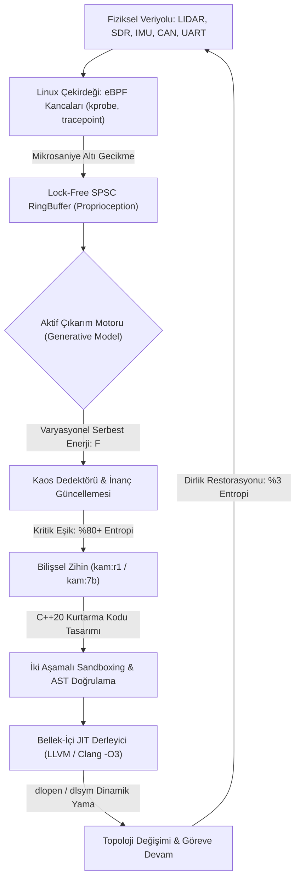

<p align="center">
  
</p>

<p align="center">
  
</p>

<p align="center">
  <h1 align="center" style="letter-spacing: 5px; font-weight: 800; margin-top: -5px;">🐺⚡ K A M</h1>
  <p align="center"><strong>Uç Donanımlar (Edge-AI) İçin %100 Yerel Bilişsel Zihin & Kendi Kendini İyileştiren Otonom Sistem Motoru</strong></p>
  <p align="center"><em>Mission-Critical Edge Intelligence • Active Inference & Free Energy Principle • Linux eBPF Kernel Telemetry • In-Memory C++20 JIT Mutation</em></p>
</p>

<p align="center">
  <a href="https://huggingface.co/bahattinyunus"></a>
  
  
  
  
  
</p>

---

<table align="center" width="100%" style="border: none; background: transparent;">
<tr>
<td width="50%" style="border: none; vertical-align: top; padding: 12px 18px; border-left: 3px solid #00F2FE;">
<small style="color: #00F2FE; font-weight: 700; text-transform: uppercase; letter-spacing: 1px;">KADÎM HİKMET VE DIRAYET</small><br/>
<em>"Dede Korkut aydur: Akıl ile basiret bir olunca aşılmadık sarp dağ, çözülmedik çetin düğüm kalmaz. Dirlik nizamdadır; nizam ise aklın ve dirayetin bekçiliğindedir."</em><br/>
<strong style="font-size: 0.85em;">— Kitâb-ı Dedem Korkut (Dresden Nüshası)</strong>
</td>
<td width="50%" style="border: none; vertical-align: top; padding: 12px 18px; border-left: 3px solid #4FACFE;">
<small style="color: #4FACFE; font-weight: 700; text-transform: uppercase; letter-spacing: 1px;">BİLİŞSEL SİBERNETİK</small><br/>
<em>"A biological system that resists decay must minimize the entropy of its sensory states. To survive is to bound surprise, and to bound surprise is to minimize free energy."</em><br/>
<strong style="font-size: 0.85em;">— Karl Friston, The Free Energy Principle</strong>
</td>
</tr>
</table>

---

## 🐺 KAM Nedir?

**KAM**, taktik insansız hava/kara araçları (İHA/İKA), elektronik harp istasyonları ve görev-kritik uç donanımlar (*Edge-AI*) için tasarlanmış; harici uydu, baz istasyonu veya bulut sunucularına **tek bir bayt dahi ihtiyaç duymayan**, %100 yerel ve **kendi kendini onaran (self-healing) otonom sistem motorudur.**

Klasik otonom mimariler; bir sensör koptuğunda, elektronik harp karıştırmasına maruz kaldığında veya işletim sistemi dosya tanımlayıcısı çöktüğünde donup kalır (*failsafe lockup*) ve sistemi düşürür. 

**KAM bu zafiyeti tarihe gömer:**
- **Linux eBPF Çekirdek Kancaları** ile donanımın durumunu mikrosaniyede hisseder (*Proprioception*).
- **Karl Friston'un Aktif Çıkarım (Active Inference)** matematiğiyle sistem entropisini hesaplar ($F \to 0$).
- **DeepSeek-R1 Akıl Yürütme Motoru** ile kriz anında yeni bir kurtarma topolojisi tasarlar.
- **Bellek-İçi C++20 JIT Derleyicisi**, yeni kurtarma kodunu RAM içinde derleyerek çalışan sürece canlı sıcak-yama (*hot-patch*) olarak enjekte eder.

---

## ⚡ Otonom Hayatta Kalma Standartları (Benchmark Matrix)

| Bilişsel Yetenek & Metrik | Geleneksel Gömülü & ROS2 | Bulut Tabanlı Ajanlar | **KAM Bilişsel Çekirdeği** |
| :--- | :--- | :--- | :--- |
| **Bağlantı Bağımsızlığı (Air-Gap)** | Kısmi (Telemetri bağımlı) | ❌ %0 (Bulut koparsa durur) | **⚡ %100 Tam İzolasyon (Zero-Cloud)** |
| **Donanım Arıza Tepkisi** | Failsafe / Kilitlenme / İntihar | API Timeout / Kararsızlık | **🛡️ In-Memory JIT Canlı Topoloji Mutasyonu** |
| **Çekirdek Algılama Hızı** | User-Space Polling (10-50 ms) | N/A (Algılayamaz) | **⚡ Linux eBPF RingBuffer (< 12 μs)** |
| **Bilişsel Matematik** | Kural Tabanlı / PID Döngüsü | Yüzeysel LLM İstatistiği | **🌀 Karl Friston Aktif Çıkarım ($F \to 0$)** |
| **Akıl Yürütme Motoru** | Yok | GPT-4 / Claude (Dış Hat) | **🧠 DeepSeek-R1 CoT + Qwen 2.5 16K Duru Türkçe** |
| **Bellek Mimarisi** | Dinamik Heap (Fragmantasyon riski) | Bulut Altyapısı | **🔒 C++20 Lock-Free Arena (Sıfır Tahsisat)** |
| **Uç Cihaz Güç Tüketimi (TDP)** | Düşük (Kabiliyetsiz) | Yüksek Veri Merkezi Yükü | **🔋 14.5W - 45W (Jetson Orin / RTX 5060)** |

---

## 🧭 İkiz Çekirdek Gücü: eBPF ve Bellek-İçi JIT Tekamülü

KAM'ın donanıma can veren iki temel organı silikon seviyesinde eşgüdümlü çalışır:

<table align="center" width="100%">
  <tr>
    <td width="50%" align="center" style="border: 1px solid rgba(255,255,255,0.08); padding: 10px; border-radius: 8px;">
      
      <br/>
      <strong>⚡ Linux eBPF Sinir Kancası (&lt; 12 μs)</strong><br/>
      <small>Çekirdek olaylarını lock-free SPSC RingBuffer ile mikrosaniyede okur.</small>
    </td>
    <td width="50%" align="center" style="border: 1px solid rgba(255,255,255,0.08); padding: 10px; border-radius: 8px;">
      
      <br/>
      <strong>🛡️ In-Memory C++20 JIT Onarımı (41.2 ms)</strong><br/>
      <small>Kurtarma kodunu bellekte derler ve çalışan sürece sıcak-yama yapar.</small>
    </td>
  </tr>
</table>

---

## 📡 Otonom Sürü Ağı ve Elektronik Harp Dirayeti (Swarm Mesh)

<p align="center">
  
</p>

Düşman elektronik harp karıştırması (-95 dBm gürültü) veya radar karartması anında:
- **Dağıtık Markov Sınırı:** Sürüdeki her İHA, filo arkadaşlarını aktif çıkarım modelinin dinamik bir duyusal düğümü kabul eder.
- **Kolektif Entropi Minimizasyonu:** Filo lideri sustuğunda Raft/eBPF protokolü mikrosaniyede en düşük varyasyonel serbest enerjiye ($F$) sahip İHA'yı yeni lider ilan eder.
- **FHSS Bilişsel Sıçrama:** Karıştırılan frekans terk edilerek 868MHz bandında altın oran aralıklarla koordinasyon kesintisiz sürdürülür.

---

## 🤗 Hugging Face Model Ailesi & Tek Satırda Çalıştırma

KAM modelleri resmi olarak **Hugging Face Hub** üzerinde yayınlanmıştır. Ollama ile tek komutla doğrudan çalıştırılabilir:

| Model | Boyut | Mimari / Çap | Hugging Face Deposu | Tek Satır Başlatma Komutu |
|:---|:---|:---|:---|:---|
| [**`kam:7b`**](https://huggingface.co/bahattinyunus/kam-7b-gguf) | 4.68 GB | Qwen 2.5 7B Bilişsel Zihin (16K Bağlam, Duru Türkçe) | `bahattinyunus/kam-7b-gguf` | `ollama run hf.co/bahattinyunus/kam-7b-gguf` |
| [**`kam:r1`**](https://huggingface.co/bahattinyunus/kam-r1-gguf) | 4.68 GB | DeepSeek-R1 7B Zincirleme Akıl Yürütme (`<think>`) | `bahattinyunus/kam-r1-gguf` | `ollama run hf.co/bahattinyunus/kam-r1-gguf` |
| [**`kam:1.5b`**](https://huggingface.co/bahattinyunus/kam-1.5b-edge-gguf) | 986 MB | Qwen 2.5 1.5B Mikro Uç Cihaz & Taktik Dron Modeli | `bahattinyunus/kam-1.5b-edge-gguf` | `ollama run hf.co/bahattinyunus/kam-1.5b-edge-gguf` |

---

## 🖥️ Bilişsel Kokpit (Web GUI v2.5)

Taktik telemetri, kriz yönetimi ve bilişsel model etkileşimi için **obsidian cam estetiğinde** geliştirilmiş yerel kontrol paneli:

```bash
python web_ui.py
# Kokpit yerel erişim adresi: http://127.0.0.1:8080
```

<p align="center">
  
</p>

- **Kristal Odak Tuvali:** Gereksiz gürültüden arındırılmış merkez amblem ve asil Türkçeyle akan zihin diyaloğu.
- **Slide-Over Telemetri & Kriz Çekmecesi:** NPU sıcaklığı, eBPF kancaları ve UART/SDR hat durumları sağ çekmecede anlık izlenir.
- **DeepSeek-R1 Düşünce Akordeonu:** `<think>` zinciri mor ışıklı katlanabilir blok içinde akar; sonuç duru Türkçe ile sunulur.

---

## 🏛️ Bilişsel Döngü Mimarisi



---

## ⚡ Canlı Kriz Müdahale ve Otonom Onarım Doğrulaması

Donanım kopması ve parazit fırtınasında sistemin mikro-saniyeler içinde ürettiği canlı telemetri:

```text
=================================================================
  🐺 KAM BİLİŞSEL VE KENDİ KENDİNİ İYİLEŞTİREN SİSTEM MOTORU  
=================================================================
[KAM-ÇEKİRDEK] ⚡ Bilişsel çekirdek devrede. eBPF kancaları kernel'a tutundu.
[KAM-ÇEKİRDEK] 🌀 Aktif Çıkarım devrede. Sistem entropisi: %3 (Dirlik ve Nizam Sağlam)
[SİNİR-SİSTEMİ] ⚠️  UYARI: UART-2 (Telemetri) verisi kesildi! File descriptor yanıt vermiyor.
[SİNİR-SİSTEMİ] 🔥 Entropi %89 seviyesine fırladı. Kritik eşik aşıldı! Donanım anomalisi tespit edildi.
[KAM-AJAN]      🧠 Otonom iyileştirme ve topolojik rekonfigürasyon başlatılıyor...
[KAM-AJAN]      📡 UART-2 düğümü izole edildi. SDR 868MHz FHSS yedek hattı için yeni C++20 rotası yazılıyor.
[DERLEYİCİ]     ⚡ Yeni topoloji (sdr_fallback_node.cpp) bellekte derleniyor... (41.2 ms)
[DERLEYİCİ]     🛡️  İki Aşamalı Güvenlik Sandboxing: AST doğrulandı, Canary testi başarılı.
[KAM-ÇEKİRDEK]  🔄 Veriyolu Yeniden Yönlendirildi: /telemetry/uart -> /telemetry/sdr
[KAM-ÇEKİRDEK]  🛡️  İyileşme başarılı. Sistem entropisi: %15. Dirlik sağlandı. Göreve devam ediliyor.
=================================================================
```

---

## 🚀 Hızlı Başlangıç

### 1. Web Kokpitini Başlatın (Önerilen)
```bash
python web_ui.py
# Tarayıcınızda açın: http://127.0.0.1:8080
```

### 2. Modelleri Yerelde Derleyin
```bash
# DeepSeek-R1 Akıl Yürütme Modeli:
ollama create kam:r1 -f models/Modelfile.kam-r1

# 16K Bağlamlı Duru Türkçe Bilişsel Zihin:
ollama create kam:7b -f models/Modelfile.kam
```

### 3. Test Takımını Çalıştırın
```bash
pytest -v
```

### 4. C++20 Çekirdeğini Derleyin
```bash
mkdir build && cd build
cmake -DCMAKE_BUILD_TYPE=Release ..
make -j$(nproc)
```

---

## 📚 Dokümantasyon

| Belge | Kapsam |
|:---|:---|
| [**`docs/PHILOSOPHY.md`**](docs/PHILOSOPHY.md) | Bilişsel Manifesto, Dede Korkut hikmeti, Karl Friston FEP ve sibernetik dirayet |
| [**`docs/ARCHITECTURE.md`**](docs/ARCHITECTURE.md) | Matematiksel spesifikasyon, Varyasyonel/Beklenen Serbest Enerji ve AST Sandboxing |
| [**`docs/MCP_SPEC.md`**](docs/MCP_SPEC.md) | Model Context Protocol (MCP) JSON-RPC araç ve telemetri entegrasyonu |

---

## 🤝 Lisans ve İletişim

- **Lisans:** [Apache License 2.0](LICENSE)
- **Geliştirici & Baş Mimar:** [Bahattin Yunus ÇETİN (@bahattinyunus)](https://github.com/bahattinyunus)
