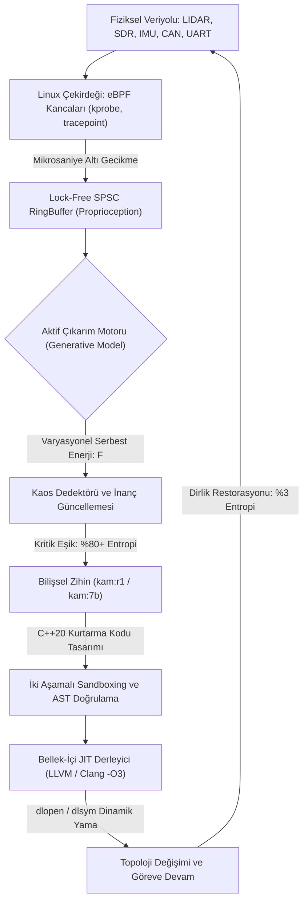

<p align="center">
  
</p>

<p align="center">
  
</p>

<p align="center">
  <h1 align="center" style="letter-spacing: 8px; font-weight: 800; margin-top: 0px;">K A M</h1>
  <p align="center"><strong>Uç Donanımlar (Edge-AI) İçin %100 Yerel Bilişsel Zihin ve Kendi Kendini İyileştiren Otonom Sistem Motoru</strong></p>
  <p align="center"><em>Mission-Critical Edge Intelligence &bull; Active Inference &amp; Free Energy Principle &bull; Linux eBPF Kernel Telemetry &bull; In-Memory C++20 JIT Mutation</em></p>
</p>

<p align="center">
  <a href="https://huggingface.co/bahattinyunus"></a>
  
  
  
  
  
</p>

---

<table align="center" width="100%" style="border: none; background: transparent;">
<tr>
<td width="50%" style="border: none; vertical-align: top; padding: 14px 20px; border-left: 3px solid #00F2FE;">
<small style="color: #00F2FE; font-weight: 700; text-transform: uppercase; letter-spacing: 1.5px;">KADİM HİKMET VE DİRAYET</small><br/>
<em>"Dede Korkut aydur: Akıl ile basiret bir olunca aşılmadık sarp dağ, çözülmedik çetin düğüm kalmaz. Dirlik nizamdadır; nizam ise aklın ve dirayetin bekçiliğindedir."</em><br/>
<strong style="font-size: 0.85em;">— Kitâb-ı Dedem Korkut (Dresden Nüshası)</strong>
</td>
<td width="50%" style="border: none; vertical-align: top; padding: 14px 20px; border-left: 3px solid #4FACFE;">
<small style="color: #4FACFE; font-weight: 700; text-transform: uppercase; letter-spacing: 1.5px;">BİLİŞSEL SİBERNETİK</small><br/>
<em>"A biological system that resists decay must minimize the entropy of its sensory states. To survive is to bound surprise, and to bound surprise is to minimize free energy."</em><br/>
<strong style="font-size: 0.85em;">— Karl Friston, The Free Energy Principle</strong>
</td>
</tr>
</table>

---

## I. Sistem Tanımı ve Otonom Mimari

**KAM**, taktik insansız hava/kara araçları (İHA/İKA), elektronik harp istasyonları ve görev-kritik uç donanımlar (*Edge-AI*) için tasarlanmış; harici uydu, baz istasyonu veya bulut sunucularına **tek bir bayt dahi ihtiyaç duymayan**, %100 yerel ve **kendi kendini onaran (self-healing) otonom sistem motorudur.**

Geleneksel gömülü mimariler; bir sensör koptuğunda, yoğun elektronik harp karıştırmasına maruz kaldığında veya işletim sistemi dosya tanımlayıcısı çöktüğünde kilitlenir (*failsafe lockup*) ve görevi sonlandırır.

**KAM, donanım kaybını çalışma zamanında otonom olarak telafi eder:**
- **Linux eBPF Çekirdek Kancaları** ile donanım ve çekirdek durumunu mikrosaniye altında algılar (*Proprioception*).
- **Karl Friston'un Aktif Çıkarım (Active Inference)** matematiğiyle sistem entropisini sürekli minimize eder ($F \to 0$).
- **DeepSeek-R1 Akıl Yürütme Motoru** ile kriz anında alternatif bir kurtarma topolojisi sentezler.
- **Bellek-İçi C++20 JIT Derleyicisi**, üretilen kurtarma kodunu doğrudan RAM içinde derleyerek çalışan sürece sıcak-yama (*hot-patch*) olarak enjekte eder.

---

## II. Otonom Hayatta Kalma Standartları (Benchmark Matrisi)

| Bilişsel Yetenek ve Metrik | Geleneksel Gömülü / ROS2 | Bulut Tabanlı Ajanlar | **KAM Bilişsel Çekirdeği** |
| :--- | :--- | :--- | :--- |
| **Bağlantı Bağımsızlığı (Air-Gap)** | Kısmi (Telemetri bağımlı) | %0 (Bulut koparsa durur) | **%100 Tam İzolasyon (Zero-Cloud)** |
| **Donanım Arıza Tepkisi** | Failsafe / Sistem Kilitlenmesi | API Timeout / Kararsızlık | **In-Memory JIT Canlı Topoloji Mutasyonu** |
| **Çekirdek Algılama Hızı** | User-Space Polling (10-50 ms) | Yok (Algılayamaz) | **Linux eBPF RingBuffer (< 12 μs)** |
| **Bilişsel Matematik** | Kural Tabanlı / PID Döngüsü | Yüzeysel LLM İstatistiği | **Karl Friston Aktif Çıkarım ($F \to 0$)** |
| **Akıl Yürütme Motoru** | Yok | Harici API (Yüksek Gecikme) | **DeepSeek-R1 CoT + Qwen 2.5 16K Duru Türkçe** |
| **Bellek Mimarisi** | Dinamik Heap (Fragmantasyon) | Sunucu Kümesi | **C++20 Lock-Free Arena (Sıfır Tahsisat)** |
| **Uç Cihaz Güç Tüketimi (TDP)** | Düşük (Bilişsel Yetenek Yok) | Veri Merkezi Ölçeği | **14.5W - 45W (Jetson Orin / RTX 5060)** |

---

## III. İkiz Çekirdek Mimarisi: eBPF ve Bellek-İçi JIT Tekamülü

KAM mimarisinin algılama ve onarım katmanları silikon seviyesinde eşgüdümlü çalışır:

<table align="center" width="100%">
  <tr>
    <td width="50%" align="center" style="border: 1px solid rgba(255,255,255,0.08); padding: 12px; border-radius: 8px;">
      
      <br/>
      <strong>Linux eBPF Sinir Kancası (&lt; 12 μs)</strong><br/>
      <small>Çekirdek olaylarını lock-free SPSC RingBuffer üzerinden sıfır kopyalama ile okur.</small>
    </td>
    <td width="50%" align="center" style="border: 1px solid rgba(255,255,255,0.08); padding: 12px; border-radius: 8px;">
      
      <br/>
      <strong>In-Memory C++20 JIT Onarımı (41.2 ms)</strong><br/>
      <small>Kurtarma kodunu bellekte derler, AST denetiminden geçirir ve canlı sürece bağlar.</small>
    </td>
  </tr>
</table>

---

## IV. Otonom Sürü Ağı ve Elektronik Harp Dirayeti

<p align="center">
  
</p>

Yoğun elektronik harp karıştırması (-95 dBm gürültü tabanı) veya GNSS/GPS karartması altında:
- **Dağıtık Markov Battaniyesi:** Sürüdeki her platform, diğer birimleri kendi generatif modelinin dinamik bir duyusal düğümü olarak işler.
- **Kolektif Entropi Minimizasyonu:** Sürü lideri devre dışı kaldığında Raft/eBPF mutabakat katmanı mikrosaniyede en düşük varyasyonel serbest enerjiye ($F$) sahip birimi yeni lider atar.
- **FHSS Bilişsel Sıçrama:** Karıştırılan frekans bandı terk edilerek 868MHz/433MHz spektrumunda kesintisiz görev koordinasyonu sürdürülür.

---

## V. Hugging Face Model Ailesi

KAM modelleri resmi olarak **Hugging Face Hub** üzerinde açık ağırlıklı GGUF formatında yayınlanmıştır. Ollama aracılığıyla tek komutla doğrudan çalıştırılabilir:

| Model | Boyut | Mimari ve Görev Profili | Hugging Face Deposu | Tek Satır Çalıştırma Komutu |
|:---|:---|:---|:---|:---|
| [**`kam:7b`**](https://huggingface.co/bahattinyunus/kam-7b-gguf) | 4.68 GB | Qwen 2.5 7B Bilişsel Zihin (16K Bağlam, Duru Türkçe) | `bahattinyunus/kam-7b-gguf` | `ollama run hf.co/bahattinyunus/kam-7b-gguf` |
| [**`kam:r1`**](https://huggingface.co/bahattinyunus/kam-r1-gguf) | 4.68 GB | DeepSeek-R1 7B Zincirleme Akıl Yürütme (`<think>`) | `bahattinyunus/kam-r1-gguf` | `ollama run hf.co/bahattinyunus/kam-r1-gguf` |
| [**`kam:1.5b`**](https://huggingface.co/bahattinyunus/kam-1.5b-edge-gguf) | 986 MB | Qwen 2.5 1.5B Mikro Uç Donanım ve Taktik İHA Modeli | `bahattinyunus/kam-1.5b-edge-gguf` | `ollama run hf.co/bahattinyunus/kam-1.5b-edge-gguf` |

---

## VI. Bilişsel Kokpit (Web Arayüzü v2.5)

Taktik telemetri, kriz simülasyonu ve yerel bilişsel model etkileşimi için geliştirilmiş düşük gecikmeli komuta arayüzü:

```bash
python web_ui.py
# Yerel Erişim Adresi: http://127.0.0.1:8080
```

<p align="center">
  
</p>

- **Odaklı Komuta Tuvali:** Dikkat dağıtıcı unsurlardan arındırılmış merkez arayüz ve gerçek zamanlı SSE akışı.
- **Açılır Telemetri ve Kriz Çekmecesi:** NPU sıcaklığı, eBPF kancaları, serbest enerji eğrisi ve donanım düğümlerini yan panelde sunar.
- **Derin Düşünce Katmanı:** `kam:r1` modelinin `<think>` akıl yürütme adımlarını katlanabilir teknik bloklar halinde ayrıştırır.

---

## VII. Bilişsel Döngü ve Topoloji Akışı



---

## VIII. Canlı Kriz Müdahalesi ve Telemetri Kaydı

Donanım kopması anında sistemin çalışma zamanında ürettiği otonom teşhis ve onarım kaydı:

```text
================================================================================
  KAM BILISSEL VE KENDI KENDINI IYILESTIREN OTONOM SISTEM MOTORU
================================================================================
[KAM-CORE]   [OK]     Bilissel cekirdek devrede. eBPF kancalari kernel'a tutundu.
[KAM-CORE]   [SYNC]   Aktif Cikarim devrede. Sistem entropisi: %3 (Dirlik ve Nizam Saglam)
[NERV-SYS]   [WARN]   UYARI: UART-2 (Telemetri) verisi kesildi. File descriptor yanit vermiyor.
[NERV-SYS]   [CRIT]   Entropi %89 seviyesine firladi. Kritik esik asildi. Donanim anomalisi.
[KAM-AGENT]  [PLAN]   Otonom iyilestirme ve topolojik rekonfigurasyon baslatiliyor...
[KAM-AGENT]  [ROUTE]  UART-2 dugumu izole edildi. SDR 868MHz FHSS yedek hatti icin C++20 rotasi yaziliyor.
[JIT-COMP]   [BUILD]  Yeni topoloji (sdr_fallback_node.cpp) bellekte derleniyor... (41.2 ms)
[JIT-COMP]   [VERIFY] Iki Asamali Guvenlik Sandboxing: AST dogrulandi, Canary testi basarili.
[KAM-CORE]   [REMAP]  Veriyolu Yeniden Yonlendirildi: /telemetry/uart -> /telemetry/sdr
[KAM-CORE]   [STABLE] Iyilesme basarili. Sistem entropisi: %15. Dirlik saglandi. Goreve devam ediliyor.
================================================================================
```

---

## IX. Hızlı Başlangıç

### 1. Web Kokpitini Başlatın
```bash
python web_ui.py
# Tarayici uzerinden erisim: http://127.0.0.1:8080
```

### 2. Modelleri Yerelde Derleyin
```bash
# DeepSeek-R1 Akil Yurutme Modeli:
ollama create kam:r1 -f models/Modelfile.kam-r1

# 16K Baglamli Duru Turkce Bilissel Zihin:
ollama create kam:7b -f models/Modelfile.kam
```

### 3. Otomatik Test Takımını Koşun
```bash
pytest -v
```

### 4. C++20 Çekirdeğini Derleyin
```bash
mkdir build && cd build
cmake -DCMAKE_BUILD_TYPE=Release ..
make -j$(nproc)
```

---

## X. Teknik Dokümantasyon ve Lisans

| Belge | Kapsam |
|:---|:---|
| [**`docs/PHILOSOPHY.md`**](docs/PHILOSOPHY.md) | Bilişsel Manifesto, Dede Korkut hikmeti, Karl Friston FEP ve sibernetik dirayet |
| [**`docs/ARCHITECTURE.md`**](docs/ARCHITECTURE.md) | Matematiksel spesifikasyon, Varyasyonel/Beklenen Serbest Enerji ve AST Sandboxing |
| [**`docs/MCP_SPEC.md`**](docs/MCP_SPEC.md) | Model Context Protocol (MCP) JSON-RPC araç ve telemetri entegrasyonu |

- **Lisans:** [Apache License 2.0](LICENSE)
- **Geliştirici ve Baş Mimar:** [Bahattin Yunus ÇETİN (@bahattinyunus)](https://github.com/bahattinyunus)
