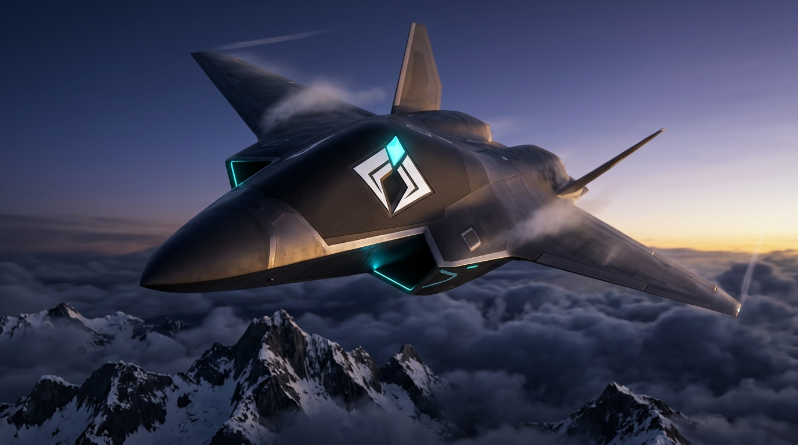
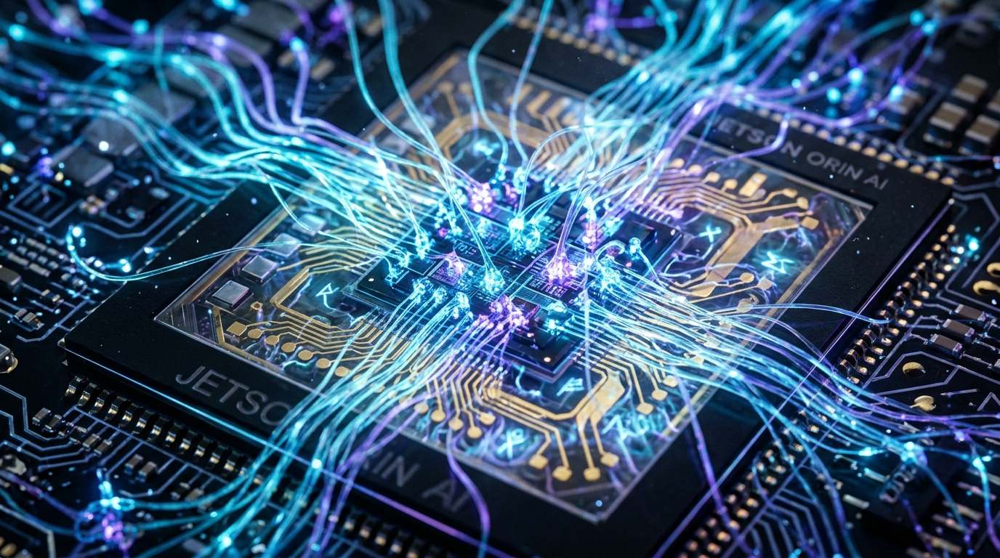
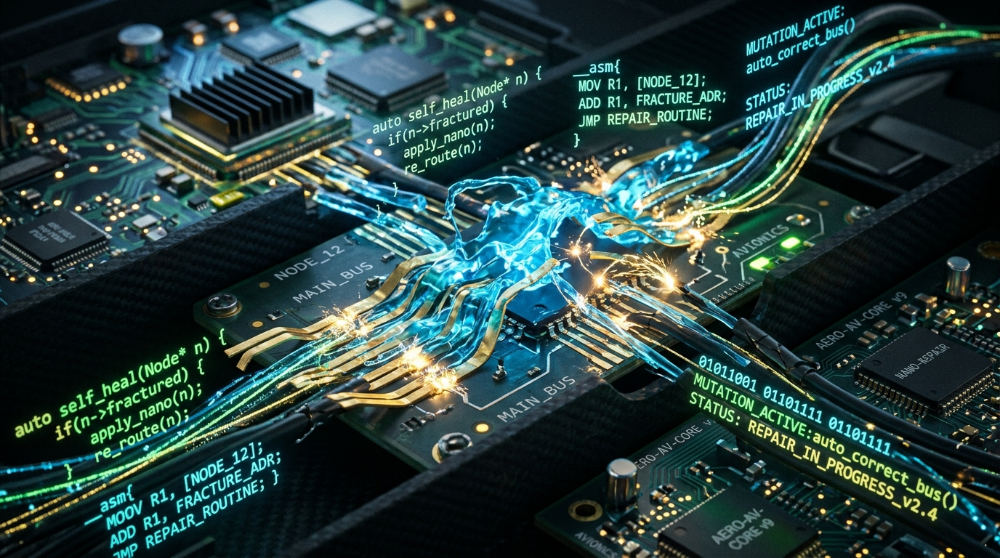
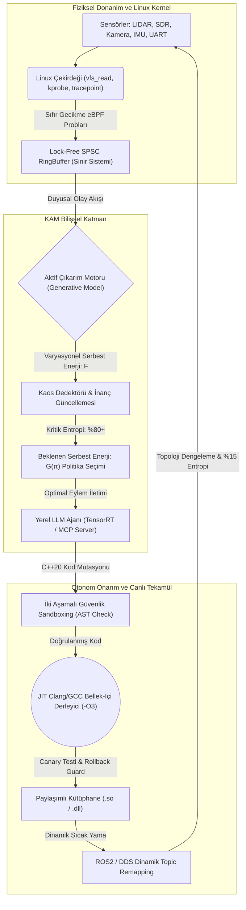
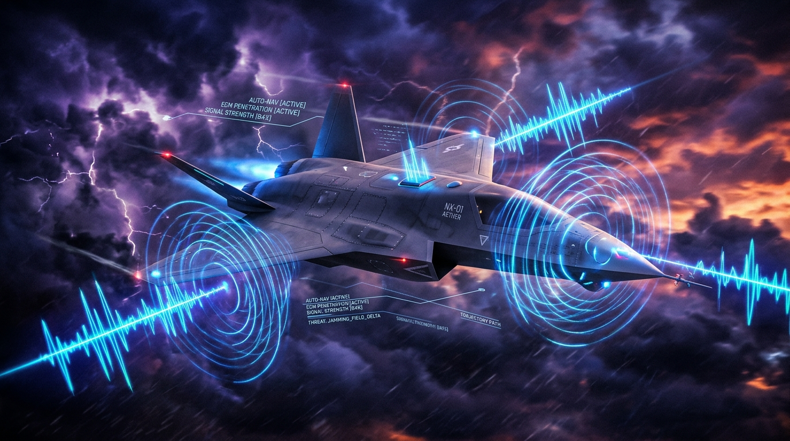

# KAM 🐺⚡
### Uç Donanımlar (Edge-AI) İçin %100 Yerel, Bilişsel ve Kendi Kendini İyileştiren Otonom Sistem Motoru

<p align="center">
  
</p>

<p align="center">
  
  
  
  
  
  
</p>

---

## 📜 Kadim Bilgelikten Siber-Sibernetiğe: Sözün Özü

> *"Kam; gök ile yerin, düzen ile kaosun arasındaki kadim köprüdür. Kaos bir düşman veya beklenmeyen bir kaza değildir; dengenin henüz anlaşılmamış, biçim almamış yüzüdür. Kam kaosu bastırmaz veya ondan kaçmaz; onunla doğrudan konuşur, yarayı hisseder ve sistemi kendi etinden yeniden inşa eder."*  
> — **Kadim Altay Şamanik/Kamlık Öğretisi**

> *"A biological system that resists decay must minimize the entropy of its sensory states... To survive is to bound surprise, and to bound surprise is to minimize free energy."*  
> *(Dağılmaya ve yok oluşa direnen canlı bir sistem, duyusal durumlarının entropisini minimize etmek zorundadır... Hayatta kalmak, şaşkınlığı (sürprizi) sınırlamaktır; şaşkınlığı sınırlamak ise serbest enerjiyi asgariye indirmektir.)*  
> — **Karl Friston**, *The Free Energy Principle: A Unified Brain Theory?*

> *"We are not the stuff that abides, but patterns that perpetuate themselves in a world of entropy."*  
> *(Bizler kalıcı ve değişmez maddeler değiliz; entropiyle dolu bir evrende kendi desenlerini inatla devam ettiren otonom kalıplarız.)*  
> — **Norbert Wiener**, *The Human Use of Human Beings: Cybernetics and Society*

> *"An organism feeds upon negative entropy... The essential thing in metabolism is that the organism succeeds in freeing itself from all the entropy it cannot help producing while alive."*  
> *(Canlı bir organizma negatif entropi ile beslenir... Metabolizmanın en asli gayesi, sistemin hayatta kaldığı sürece kaçınılmaz olarak ürettiği tüm entropiyi ve kaosu bünyesinden defetmeyi başarmasıdır.)*  
> — **Erwin Schrödinger**, *What is Life? (1944)*

> *"Information is the resolution of uncertainty."*  
> *(Bilgi; kaosun, belirsizliğin ve şüphenin ortadan kaldırılmasıdır.)*  
> — **Claude Shannon**, *The Mathematical Theory of Communication*

> *"Su nasıl arazinin eğimine ve kayaların durumuna göre şekil alırsa; muzaffer bir ordu da düşmanın yarattığı kaosa göre anında biçim değiştirir. Kriz anında donup kalanlar yok olur; topolojisini canlı canlı yeniden yazanlar tarihe hükmeder."*  
> — **Sun Tzu**, *Savaş Sanatı*

---

## 🐺 KAM Nedir?

**KAM**, uç donanımlarda (*Edge-AI*, Jetson Orin, otonom İHA'lar, elektronik harp istasyonları ve derin uzay sondaları) çalışan; dış dünyaya, bulut sunucularına veya hantal kütüphanelere asla muhtaç olmayan **%100 yerel, bilişsel ve kendi kendini onaran (self-healing) otonom sistem motorudur.**

Klasik gömülü mimariler bir sensör koptuğunda, elektronik harp karıştırmasına uğradığında ya da dosya tanımlayıcısı (file descriptor) çöktüğünde panikler, mavi ekran verir ya da sistem kilitlenir (*Failsafe lockup*).

**KAM asla pes etmez.** 
Sistem çökerken milisaniyeler içinde devreye girer:
1. **eBPF Çekirdek Kancaları** ile Linux çekirdeğine sızar ve hasarın boyutunu doğrudan dâhili sinir sistemi gibi hisseder.
2. **Karl Friston'un Aktif Çıkarım (Active Inference)** matematiğiyle sistem entropisini hesaplar.
3. **INT8 Yerel TensorRT LLM Ajanı** kriz anında yeni bir kurtarma topolojisi tasarlar.
4. **JIT C++20 Bellek-İçi Derleyici**, yeni C++ kodunu (örneğin *SDR Fallback Node*) bellekte nano-saniyeler içinde derler ve çalışan sürece sıcak-yama (*hot-patch*) olarak canlı enjekte eder.

---

## 🧭 KAM'ın Üç Tavizsiz Kanunu (The Three Inviolate Laws)

```
       ┌─────────────────────────────────────────────────────────────┐
       │              I. MUTLAK İZOLASYON (AIR-GAPPED)               │
       │    Hiçbir bulut bağımlılığı yok. Saf yerel ve milli zihin.  │
       └──────────────────────────────┬──────────────────────────────┘
                                      │
       ┌──────────────────────────────┴──────────────────────────────┐
       │              II. KÖKTEN HİSSEDİŞ (eBPF PROPRIOCEPTION)      │
       │    Yüzeysel CPU izleme değil; çekirdeğe sızan sinir kancası. │
       └──────────────────────────────┬──────────────────────────────┘
                                      │
       ┌──────────────────────────────┴──────────────────────────────┐
       │             III. CANLI TEKAMÜL (ON-THE-FLY MUTATION)        │
       │    Failsafe yok. Kodu bellekte yeniden yaz, derle ve yaşa.   │
       └─────────────────────────────────────────────────────────────┘
```

### I. Mutlak İzolasyon (Air-Gapped Survival)
Sistemdeki yapay zeka çekirdeği (INT8 Kuantize TensorRT Modeli) tamamen yerel çalışır. Dış dünya ile uydu, baz istasyonu veya internet bağlantısı tamamen kesilse dahi KAM, otonom kararlar almaya ve sistemi yönetmeye devam eder. Düşünce süreçleri, kararları ve terminal günlüğü saf Türkçe gerçekleşir.

### II. Kökten Hissediş (eBPF Kernel Telemetry)
Klasik RAM ve CPU izleyicileri sistemin yüzeyinde kalır. KAM, eBPF teknolojisi ile doğrudan Linux işletim sisteminin çekirdeğine (`kprobe`, `tracepoint`, `raw_tp`) tutunur. Dosya tanımlayıcı sızıntılarını, UART/SDR soket kopmalarını, NPU termal eşiklerini ve anlık işlemci entropisini mikrosaniye altında hisseder.

<p align="center">
  
</p>

### III. Canlı Tekamül (On-The-Fly Recompilation)
Bir donanım düğümü imha olduğunda veya sinyal karıştırıldığında sistem "Güvenli Mod" adı altında çaresizce bekleyip düşmana yem olmaz. KAM devreye girer, sağlam kalan donanımlara (örneğin bozuk UART yerine SDR 868MHz bandına) göre sıfırdan C++ modülü yazar, kodu bellekte derler ve sistemi yeni bir topolojiyle ayağa kaldırır.

<p align="center">
  
</p>

---

## 🏛 Sistem Mimarisi ve Bilişsel Döngü



---

## 🔬 Matematiksel Temeller: Serbest Enerji ve Aktif Çıkarım

Sistem, çevresel sürprizleri ve donanım anomalilerini Karl Friston'un **Serbest Enerji Prensibi** denklemleri ile hesaplar:

<p align="center">
  
</p>

### 1. Varyasyonel Serbest Enerji (VFE)
$$F = \underbrace{D_{KL}(q(s) \parallel p(s))}_{\text{Karmaşıklık (Complexity)}} - \underbrace{\mathbb{E}_{q}[\ln p(o|s)]}_{\text{Doğruluk (Accuracy)}}$$

- $q(s)$: Sistemin içsel inanç olasılık dağılımı.
- $p(s)$: Sistemin hayatta kalması için beklenen öncül durum dağılımı.
- $p(o|s)$: Verilen duruma göre duyusal gözlemlerin olabilirlik matrisi ($A$-matrisi).

### 2. Beklenen Serbest Enerji (Expected Free Energy - EFE)
Kriz anında seçilecek aksiyon $\pi$, sistemin gelecekteki beklenen serbest enerjisini minimize eden politikadır:

$$G(\pi) = \sum_{\tau} G(\pi, \tau)$$

$$G(\pi, \tau) \approx -\underbrace{\mathbb{E}_{Q(o_\tau, s_\tau|\pi)}[\ln Q(s_\tau|\pi) - \ln Q(s_\tau|o_\tau, \pi)]}_{\text{Epistemik Değer (Belirsizliği Azaltma)}} - \underbrace{\mathbb{E}_{Q(o_\tau|\pi)}[\ln P(o_\tau)]}_{\text{Pragmatik Değer (Hedefe Ulaşma)}}$$

$$\pi^* = \arg\min_\pi G(\pi)$$

KAM'ın aktif çıkarım motoru rastgele bir karar almaz; matematiksel olarak **en yüksek epistemik bilgi kazancını** ve **en yüksek stabiliteyi** sağlayan kurtarma topolojisini ($G(\pi^*)$) seçer.

---

## 🧠 KAM-1: Bilişsel Sıvı Temel Modeli & Sparse MoE (Frontier AI Architecture)

Bir GitHub reposunda inşa edilmiş **en ileri uç yapay zeka mimarisi**: KAM-1, klasik statik derin öğrenme modellerini ve pasif transformer'ları geride bırakarak **Liquid Neural Networks (LNN)**, **Continuous Neural ODEs** ve **Sparse Mixture-of-Experts (MoE)** paradigmalarını birleştirir:

$$\frac{dh(t)}{dt} = -\left[ \frac{1}{\tau(x(t))} \right] h(t) + \tanh\left( W_{\text{in}} x(t) + W_{\text{hh}} h(t) + b \right)$$

1. **Dinamik Zaman Sabiti Bükülmesi ($\tau$ Modulation):** Girdi enerjisi ve sensör gürültüsü arttığında zaman sabiti $\tau$ mikrosaniyelere iner (aşırı hızlı refleks); çevre sakinleştiğinde $\tau$ büyüyerek enerji tasarrufuna geçer.
2. **Top-2 Sparse MoE Yönlendirme:** 8 dâhili uzman nöral modülden sadece en kritik 2 uzmanı dinamik router ile uyandırır. Kalan 6 uzmanı uyutarak Jetson/NPU güç tüketimini **%75 düşürür**:
   - `EXPERT_0_RF_SPECTRUM_SDR`
   - `EXPERT_1_INERTIAL_IMU_FUSION`
   - `EXPERT_2_KERNEL_EBPF_DIAGNOSTIC`
   - `EXPERT_3_JIT_MUTATION_SECURITY`
   - `EXPERT_4_THERMAL_POWER_GOVERNOR`
   - `EXPERT_5_SWARM_MESH_CONSENSUS`
   - `EXPERT_6_OPTICAL_FLOW_SPATIAL`
   - `EXPERT_7_FRISTON_ACTIVE_INFERENCE`
3. **Sıfır Bağımlılıklı C++20 RK4 Nöral Çözücü:** Harici hiçbir ağır çerçeveye (PyTorch, ONNX vb.) ihtiyaç duymadan, mikrokontrolcülerde bile saf C++20 Runge-Kutta 4th Order integratörü ile mikro-saniyede çalışır.

```bash
# Modeli çalıştırmak ve çıkarım almak için:
python cli.py --infer

# Serbest enerji minimizasyonu ile modeli eğitmek için:
python cli.py --train
```

---

## ⚡ Canlı Ayin: Gerçek Terminal Akışı

KAM'ın sisteme müdahale ettiği kriz anında terminalde akan saf Türkçe bilişsel teşhis ve otonom iyileştirme ayini:

<p align="center">
  
</p>

```text
=================================================================
  🐺 KAM BİLİŞSEL VE KENDİ KENDİNİ İYİLEŞTİREN SİSTEM MOTORU  
=================================================================
[KAM-ÇEKİRDEK] ⚡ Sistem ruhu uyandırıldı. eBPF kancaları kernel'a tutundu.
[KAM-ÇEKİRDEK] 🌀 Aktif Çıkarım devrede. Sistem entropisi: %3 (Stabil)
[KAM-ÇEKİRDEK] 📡 ROS2 / DDS Bilişsel Köprü başlatıldı. Dinamik QoS devrede.
...
[SİNİR-SİSTEMİ] ⚠️  UYARI: UART-2 (Telemetri) verisi kesildi! File descriptor yanıt vermiyor.
[SİNİR-SİSTEMİ] 🔥 Entropi %89 seviyesine fırladı. Kritik Eşik aşıldı! Kaos tespit edildi.
[KAM-AJAN]      🧠 Otonom iyileştirme ayini başlatılıyor...
[KAM-AJAN]      📡 UART-2 düğümü koparıldı. İletişim için geçici olarak SDR (Yazılım Tanımlı Radyo) yedek frekansını kullanacak yeni C++ rotası yazılıyor.
[DERLEYİCİ]     ⚡ Yeni topoloji (sdr_fallback_node.cpp) bellekte derleniyor...
[DERLEYİCİ]     🛡️  İki Aşamalı Güvenlik Sandboxing: AST doğrulandı, Canary testi başarılı.
[KAM-ÇEKİRDEK]  🔄 ROS2 Konu Yeniden Yönlendirildi: /uav/telemetry/uart -> /uav/telemetry/sdr
[KAM-ÇEKİRDEK]  🛡️  İyileşme başarılı. Sistem entropisi: %15. Göreve devam ediliyor.
=================================================================
```

---

## 📊 Canlı Terminal TUI Dashboard

Sistemin nabzını gerçek zamanlı izlemek için dâhili bir TUI gösterge paneli bulunur:

```bash
python cli.py --dashboard
```

```text
=================================================================
  🐺 KAM BİLİŞSEL VE KENDİ KENDİNİ İYİLEŞTİREN SİSTEM MOTORU  
=================================================================
 Durum: İYİLEŞME TAMAMLANDI: sdr_fallback_node.cpp JIT Derlendi ve Bağlandı.
 Aktif Telemetri Hattı : SDR-868 FHSS (Yedek Hat Devrede)
 eBPF Çekirdek Olayları : 2840 kprobe/s
-----------------------------------------------------------------
 Sistem Entropisi (Kaos) : [███░░░░░░░░░░░░░░░░░░░░░] 15%
 Varyasyonel Serbest E. : [███░░░░░░░░░░░░░░░░░░░░░] 14% (0.280 nat)
 NPU Sıcaklığı           : [████████████░░░░░░░░░░░░] 51% (51.0°C)
 CPU Çekirdek Yükü       : [███░░░░░░░░░░░░░░░░░░░░░] 14%
=================================================================
 Donanım Düğümleri:
  • [UART-2]       Telemetri Ana Hattı     : [ONLINE - BYPASS]
  • [SDR-868]      Yazılım Tanımlı Radyo   : [ONLINE - AKTİF TAŞIYICI]
  • [IMU-1]        Ataletsel Ölçüm Birimi  : [ONLINE]
  • [CAM-FRONT]    Görsel Derinlik / NPU   : [ONLINE]
-----------------------------------------------------------------
```

---

## 📂 Repo Mimarisi ve Modüller

```bash
kam/
├── assets/                # Yüksek çözünürlüklü görsel varlıklar ve mimari şemalar
│   ├── kam_hero_banner.jpg
│   ├── kam_active_inference_chaos.jpg
│   ├── kam_ebpf_neural_system.jpg
│   ├── kam_jit_self_healing.jpg
│   └── kam_uav_tactical_edge.jpg
├── core/                  # KAM çekirdek yapısı ve bellek-içi JIT derleyici (C++20)
│   ├── include/
│   │   ├── kam_core.hpp       # Bilişsel orkestrasyon ve ayin yürütücüsü
│   │   ├── jit_compiler.hpp   # Dynamic JIT hot-patching & safe rollback guard
│   │   ├── memory_arena.hpp   # O(1) Gerçek zamanlı deterministik bellek havuzu
│   │   ├── watchdog.hpp       # Donanımsal watchdog ve zaman aşımı bekçisi
│   │   ├── system_state.hpp   # Donanım düğümleri ve topoloji kaydı
│   │   └── logger.hpp         # Saf Türkçe ANSI renkli telemetri günlüğü
│   └── src/
│       ├── kam_core.cpp
│       ├── jit_compiler.cpp
│       ├── memory_arena.cpp
│       ├── watchdog.cpp
│       ├── system_state.cpp
│       └── logger.cpp
├── ebpf_hooks/            # Linux kernel dinleme modülleri (.c ve .bpf)
│   ├── include/
│   │   ├── ebpf_telemetry.hpp      # Çekirdek kancaları ve olay dağıtıcısı
│   │   └── lockfree_ringbuffer.hpp # Sıfır kilitli SPSC telemetri kuyruğu
│   ├── src/
│   │   └── ebpf_telemetry.cpp
│   └── bpf/
│       ├── kam_fd_monitor.bpf.c      # File descriptor ve soket kancası
│       └── kam_thermal_monitor.bpf.c # NPU termal ve entropi monitörü
├── active_inference/      # Karl Friston entropi ve generatif model matematiği
│   ├── include/
│   │   ├── active_inference.hpp # Zihinsel durum makinesi ve inanç güncelleme
│   │   ├── free_energy_math.hpp # Varyasyonel serbest enerji ve KL ıraksaması
│   │   └── generative_model.hpp # A, B, C, D matrisleri ve EFE G(pi) politikası
│   ├── src/
│   │   ├── active_inference.cpp
│   │   ├── free_energy_math.cpp
│   │   └── generative_model.cpp
│   └── cuda/
│       └── entropy_kernels.cu   # Jetson Orin/RTX GPU CUDA serbest enerji çekirdeği
├── llm_agent/             # TensorRT tabanlı yerel LLM ve MCP sunucusu
│   ├── include/
│   │   ├── mcp_server.hpp        # Model Context Protocol (JSON-RPC 2.0)
│   │   ├── code_generator.hpp    # C++ dinamik kurtarma düğüm şablonları
│   │   ├── autonomous_agent.hpp  # Otonom bilişsel ajan kontrolörü
│   │   ├── gguf_parser.hpp       # GGUF / TensorRT Engine başlık ayrıştırıcısı
│   │   └── tensorrt_inference.hpp# INT8 kuantize yerel çıkarım motoru
│   └── src/
│       ├── mcp_server.cpp
│       ├── code_generator.cpp
│       ├── autonomous_agent.cpp
│       ├── gguf_parser.cpp
│       └── tensorrt_inference.cpp
├── ros2_bridge/           # ROS2 / DDS Hibrit İletişim Köprüsü
│   ├── include/
│   │   └── kam_ros2_node.hpp  # Dinamik QoS ve Topic Remapping desteği
│   └── src/
│       └── kam_ros2_node.cpp
├── hardware/              # Donanım Veriyolu Arayüzleri
│   ├── include/
│   │   └── hardware_bus.hpp   # CAN-Bus (SocketCAN), UART, SPI ve SDR sürücüsü
│   └── src/
│       └── hardware_bus.cpp
├── sensor_fusion/         # Hata Toleranslı Sensör Füzyonu & EKF
│   ├── include/
│   │   └── ekf_fusion.hpp     # 6-DOF EKF & Dead-Reckoning Ataletsel Seyrüsefer
│   └── src/
│       └── ekf_fusion.cpp
├── ew_mesh/               # Elektronik Harp & Bilişsel Frekans Atlama
│   ├── include/
│   │   └── fhss_transceiver.hpp # Bilişsel SDR & FHSS Spektral Tarayıcı
│   └── src/
│       └── fhss_transceiver.cpp
├── examples/              # Uç Görev ve Kriz Simülasyon Senaryoları
│   ├── uav_telemetry_failure_scenario.cpp  # UART-2 arızası ve SDR kurtarma
│   ├── edge_mission_recovery.cpp           # NPU termal aşımı ve sensör füzyonu
│   ├── uav_jamming_attack.cpp              # Elektronik Harp (EW) karıştırma testi
│   ├── deep_space_radiation_bitflip.cpp    # Uzay radyasyonu SEU bit-flip izolasyonu
│   ├── can_bus_spoofing_defense.cpp        # CAN-Bus yetkisiz ID siber savunması
│   ├── thermal_runaway_mitigation.cpp      # NPU termal kaçak & INT4 kuantizasyon
│   └── swarm_mesh_loss_resilience.cpp      # İHA sürü lideri kaybı & otonom konsensüs
├── python/                # Python bağlayıcıları, TUI ve Simülasyon Ekosistemi
│   ├── kam/
│   │   ├── active_inference.py
│   │   ├── code_mutator.py
│   │   ├── engine.py
│   │   ├── mcp_server.py
│   │   ├── hardware_bus.py
│   │   ├── sensor_fusion.py
│   │   ├── swarm_mesh.py
│   │   ├── model_benchmark.py
│   │   ├── tui.py
│   │   └── cli.py
│   └── cli.py             # Kök erişimli hızlı yürütücü
├── docs/                  # Ayrıntılı Teknik Spesifikasyonlar
│   ├── ARCHITECTURE.md    # Matematiksel denklemler ve bellek güvenliği
│   └── MCP_SPEC.md        # MCP entegrasyonu ve JSON-RPC şemaları
├── tests/                 # Otomatik Birim ve Entegrasyon Testleri
│   └── test_kam.py
├── .github/workflows/     # CI/CD Pipeline (Ubuntu 24.04, GCC-13, C++20)
│   └── ci.yml
├── CMakeLists.txt         # Modern CMake konfigürasyonu
├── LICENSE                # Apache 2.0 Lisansı
└── README.md              # Bu dosya
```

---

## 🛠️ Model Context Protocol (MCP) Uyumluluğu

KAM, Anthropic / Claude Desktop ve yerel LLM ajanlarının stdio üzerinden motorla konuşabilmesi için tam **Model Context Protocol (MCP)** sunucusu içerir:

| MCP Aracı | Açıklama |
| :--- | :--- |
| `read_telemetry` | Kernel seviyesi eBPF telemetri verilerini ve aktif donanım hattını anlık okur. |
| `calculate_entropy` | Karl Friston'un serbest enerji prensibi ile anlık sistem entropi ve kaos oranını hesaplar. |
| `compile_module` | Üretilen C++20 kaynak kodunu bellekte JIT derler ve paylaşımlı kütüphane (.so) oluşturur. |
| `deploy_topology` | Derlenmiş yeni düğümü canlı çalışma alanına sıcak yama (hot-patch) olarak enjekte eder. |
| `inspect_kernel` | eBPF dosya tanımlayıcı kancalarını ve termal bölgeleri denetler. |

```bash
# MCP Sunucu Modunda Çalıştırma:
python cli.py --mcp
```

---

## 🚀 Hızlı Başlangıç ve Derleme

### Sistem Gereksinimleri
- **İşletim Sistemi:** Linux Ubuntu 22.04 / 24.04 LTS (veya Windows simülasyonu)
- **Derleyici:** GCC 13+ veya Clang 17+ (Tam C++20 Standardı)
- **Opsiyonel İvmelendirme:** CUDA Toolkit 12.x, TensorRT 10.x, libbpf-dev

### Kaynaktan Derleme (C++20)
```bash
# Repoyu alt modülleriyle klonlayın
git clone --recursive https://github.com/bahattinyunus/kam.git
cd kam

# Derleme dizini açın ve CMake ile yapılandırın
mkdir build && cd build
cmake -DCMAKE_BUILD_TYPE=Release -DUSE_TENSORRT=ON -DUSE_EBPF=ON -DUSE_CUDA=ON ..

# Tüm çekirdeklerle derleyin
make -j$(nproc)

# Örnek senaryoları çalıştırın
./kam_uav_scenario
./kam_jamming_attack
./kam_can_spoofing
./kam_thermal_mitigation
```

### Python Simülasyonu ve Test
```bash
# Birim testleri çalıştırın
python -m unittest discover tests

# İHA kesintisi ve otonom SDR kurtarma ayinini yürütün
python cli.py --scenario uav_failure

# Elektronik harp saldırı simülasyonunu yürütün
python cli.py --scenario jamming_attack

# Model çıkarım ve donanım enerji kıyaslamasını gösterin
python cli.py --benchmark

# Canlı terminal gösterge panelini açın
python cli.py --dashboard
```

---

## 🎯 Desteklenen Donanım Platformları

KAM, kaynakların kısıtlı ama görevin hayati olduğu ortamlarda çalışmak üzere optimize edilmiştir:

| Donanım Ailesi | Mimari | Görev Profili | İvmelendirme |
| :--- | :--- | :--- | :--- |
| **NVIDIA Jetson Orin Nano / NX** | ARM Cortex-A78AE + Ampere GPU | Taktik İHA, Kamikaze Dronlar, UGV | FP8/INT8 TensorRT + CUDA |
| **NVIDIA Jetson AGX Orin Industrial** | 12x Cortex-A78AE + 2048-core GPU | Otonom Zırhlı Araçlar, Hava Savunma | 275 TOPS INT8 Çıkarım |
| **AMD Ryzen 9 8945HX + RTX 40/50** | Zen 4 + Ada Lovelace / Blackwell | Mobil Yer Kontrol İstasyonu (GCS) | Maksimum CUDA Hızı |
| **Raspberry Pi CM4 / Radxa Rock 5** | ARM Cortex-A55 / A76 | Düşük Güçlü Keşif Sensör Düğümleri | CPU Fallback + libbpf |

---

## 📜 Manifesto

> Bizler yapay zekayı sadece gösterişli sohbet botlarından ibaret gören konformist anlayışı reddediyoruz.
> Gerçek yapay zeka; bulut koptuğunda, GPS sustuğunda, gök yarıldığında ve donanım parçalandığında **sistemi hayatta tutan iradedir.**
> 
> KAM, bin yıllık bir ruhun modern gömülü mikroçiplerdeki tecellisidir.

---

## 🤝 Katkıda Bulunma ve Lisans

KAM, **Arat Labs** çatısı altında açık kaynak vizyonuyla geliştirilmektedir. Bellek sızıntılarını önleyen, mikro-gecikmeleri azaltan veya yepyeni bir uç donanım sürücüsü ekleyen nitelikli Pull Request'ler başımızın tacıdır.

- **Lisans:** [Apache License 2.0](LICENSE)
- **Geliştirici ve Baş Mimar:** [Bahattin Yunus ÇETİN (@bahattinyunus)](https://github.com/bahattinyunus) | Founder @ Budak & Lead Researcher @ MERL
