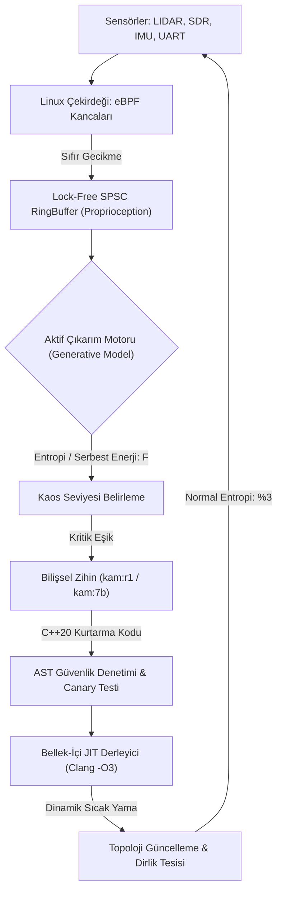

<p align="center">
  
</p>

<p align="center">
  <h1 align="center">🐺⚡ K A M</h1>
  <p align="center"><strong>Uç Donanımlar (Edge-AI) İçin %100 Yerel Bilişsel Zihin & Kendi Kendini İyileştiren Otonom Sistem Motoru</strong></p>
  <p align="center"><em>Air-Gapped Edge AI • Karl Friston Active Inference • Linux eBPF Kernel Telemetry • In-Memory C++20 JIT Mutation</em></p>
</p>

<p align="center">
  <a href="https://huggingface.co/bahattinyunus"></a>
  
  
  
  
  
</p>

<p align="center">
  
</p>

---

> *"Dede Korkut aydur: Akıl ile basiret bir olunca aşılmadık sarp dağ, çözülmedik çetin düğüm kalmaz. Dirlik nizamdadır; nizam ise aklın ve dirayetin bekçiliğindedir."*  
> — **Kitâb-ı Dedem Korkut (Dresden Nüshası)**
>
> *"To survive is to bound surprise, and to bound surprise is to minimize free energy."*  
> — **Karl Friston, The Free Energy Principle**

---

## 🐺 KAM Nedir?

**KAM**, taktik İHA/SİHA aviyonikleri, elektronik harp istasyonları ve görev-kritik uç donanımlar (*Edge-AI*) için geliştirilmiş; buluta veya harici ağlara muhtaç olmayan **%100 yerel, bilişsel ve kendi kendini onaran (self-healing) otonom sistem motorudur.**

Klasik gömülü sistemler bir sensör koptuğunda veya elektronik harp karıştırmasında (*jamming*) donup kalırken (*failsafe lockup*); KAM, Karl Friston'un **Serbest Enerji Prensibi** ve **eBPF çekirdek kancaları** ile krizi mikro-saniyede teşhis eder, bellek-içi C++20 JIT derleyicisiyle canlı sürece yeni bir topoloji enjekte eder.

---

## 🧭 Üç Tavizsiz İlke

```
┌─────────────────────────────────────────────────────────────────────────┐
│ I. MUTLAK İZOLASYON (AIR-GAPPED)                                        │
│ Sıfır bulut bağımlılığı. Görev anında tamamen yerel, bağımsız zihin.   │
├─────────────────────────────────────────────────────────────────────────┤
│ II. ÇEKİRDEK SEVİYESİ BASİRET (eBPF PROPRIOCEPTION)                    │
│ Yüzeysel telemetri değil; Linux çekirdeğine doğrudan tutunan sinir ağı. │
├─────────────────────────────────────────────────────────────────────────┤
│ III. CANLI TEKAMÜL (IN-MEMORY JIT MUTATION)                             │
│ Failsafe yok. Kodu bellekte derle, sıcak-yama yap ve görevi sürdür.    │
└─────────────────────────────────────────────────────────────────────────┘
```

---

## 🤗 Hugging Face Model Ailesi

KAM modelleri resmi olarak **Hugging Face Hub** üzerinde yayınlanmıştır. Ollama ile tek komutla çalıştırılabilir:

| Model | Boyut | Açıklama | Tek Satır Çalıştırma Komutu |
|:---|:---|:---|:---|
| [**`kam:7b`**](https://huggingface.co/bahattinyunus/kam-7b-gguf) | 4.68 GB | Qwen 2.5 7B Bilişsel Zihin (16K Bağlam, Duru Türkçe) | `ollama run hf.co/bahattinyunus/kam-7b-gguf` |
| [**`kam:r1`**](https://huggingface.co/bahattinyunus/kam-r1-gguf) | 4.68 GB | DeepSeek-R1 7B Zincirleme Akıl Yürütme (`<think>`) | `ollama run hf.co/bahattinyunus/kam-r1-gguf` |
| [**`kam:1.5b`**](https://huggingface.co/bahattinyunus/kam-1.5b-edge-gguf) | 986 MB | Qwen 2.5 1.5B Mikro Uç Cihaz & Dron Modeli | `ollama run hf.co/bahattinyunus/kam-1.5b-edge-gguf` |

---

## 🖥️ Bilişsel Kokpit (Web GUI v2.5)

Taktik izleme ve bilişsel model etkileşimi için yerel, lüks ve dikkat dağıtmayan tarayıcı kokpiti:

```bash
python web_ui.py
# Kokpite erişim: http://127.0.0.1:8080
```

<p align="center">
  
</p>

- **Odaklı Sohbet Tuvali:** Dikkat dağıtmayan, kristal berraklığında merkez arayüz.
- **Slide-Over Telemetri Çekmecesi:** Çekirdek metrikleri ve kriz masasını tek tıkla açılan yan çekmecede saklar.
- **DeepSeek-R1 Düşünce Akordeonu:** `<think>` zincirini mor ışıklı katlanabilir blok içinde düzenler.

---

## 🏛️ Bilişsel Döngü Mimarisi



---

## ⚡ Canlı Kriz Müdahale Akışı

Donanım kopması anında terminalde gerçekleşen otonom iyileştirme:

```text
=================================================================
  🐺 KAM BİLİŞSEL VE KENDİ KENDİNİ İYİLEŞTİREN SİSTEM MOTORU  
=================================================================
[KAM-ÇEKİRDEK] ⚡ Bilişsel çekirdek devrede. eBPF kancaları kernel'a tutundu.
[KAM-ÇEKİRDEK] 🌀 Aktif Çıkarım devrede. Sistem entropisi: %3 (Dirlik Sağlam)
[SİNİR-SİSTEMİ] ⚠️  UYARI: UART-2 verisi kesildi! File descriptor yanıt vermiyor.
[SİNİR-SİSTEMİ] 🔥 Entropi %89 seviyesine fırladı. Donanım anomalisi tespit edildi.
[KAM-AJAN]      🧠 Otonom iyileştirme başlatılıyor... SDR-868MHz rotası yazılıyor.
[DERLEYİCİ]     ⚡ Yeni topoloji (sdr_fallback_node.cpp) bellekte derleniyor...
[DERLEYİCİ]     🛡️  İki Aşamalı Sandboxing: AST doğrulandı, Canary testi başarılı.
[KAM-ÇEKİRDEK]  🔄 Konu Yeniden Yönlendirildi: /telemetry/uart -> /telemetry/sdr
[KAM-ÇEKİRDEK]  🛡️  İyileşme başarılı. Sistem entropisi: %15. Dirlik sağlandı.
=================================================================
```

---

## 🚀 Hızlı Başlangıç

### 1. Web Kokpitini Başlatın
```bash
python web_ui.py
```
Tarayıcınızda açın: `http://127.0.0.1:8080`

### 2. Modelleri Yerelde Derleyin
```bash
# DeepSeek-R1 Akıl Yürütme Modeli:
ollama create kam:r1 -f models/Modelfile.kam-r1

# 16K Bağlamlı Duru Türkçe Modeli:
ollama create kam:7b -f models/Modelfile.kam
```

### 3. Test Takımını Koşun
```bash
pytest -v
```

### 4. C++20 Motorunu Derleyin
```bash
mkdir build && cd build
cmake -DCMAKE_BUILD_TYPE=Release ..
make -j$(nproc)
```

---

## 📚 Dokümantasyon

| Belge | Kapsam |
|:---|:---|
| [**`docs/PHILOSOPHY.md`**](docs/PHILOSOPHY.md) | Bilişsel Manifesto, Dede Korkut hikmeti, FEP ve sibernetik dirayet |
| [**`docs/ARCHITECTURE.md`**](docs/ARCHITECTURE.md) | Matematiksel spesifikasyon, VFE/EFE formülleri ve bellek güvenliği |
| [**`docs/MCP_SPEC.md`**](docs/MCP_SPEC.md) | Model Context Protocol (MCP) JSON-RPC araç entegrasyonu |

---

## 🤝 Lisans ve İletişim

- **Lisans:** [Apache License 2.0](LICENSE)
- **Geliştirici & Baş Mimar:** [Bahattin Yunus ÇETİN (@bahattinyunus)](https://github.com/bahattinyunus)
