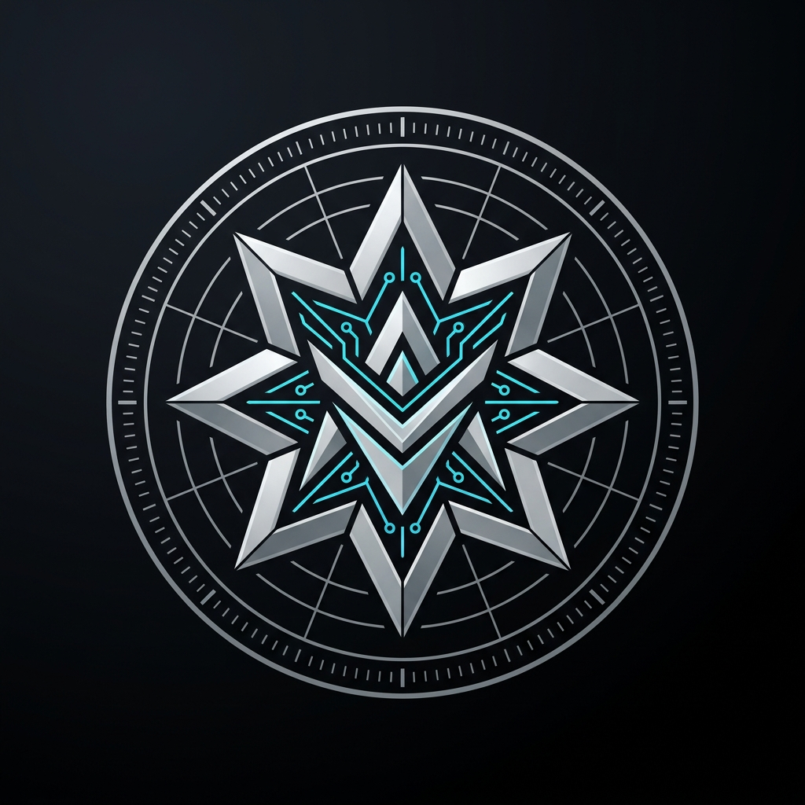

<p align="center">
  
</p>

<h1 align="center">K A M</h1>

<p align="center">
  <strong>%100 Yerel Bilişsel Zihin, Otonom Bilgisayar Ajanı ve Kendi Kendini Onaran Uç Sistem Motoru</strong>
</p>

<p align="center">
  <a href="https://huggingface.co/bahattinyunus"></a>
  
  
  
  <a href="LICENSE"></a>
</p>

<p align="center">
  <em>"Dirlik nizamdadır; nizam ise aklın ve dirayetin bekçiliğindedir."</em> — <strong>Dede Korkut</strong><br/>
  <em>"To survive is to bound surprise, and to bound surprise is to minimize free energy."</em> — <strong>Karl Friston</strong>
</p>

---

## Nedir?

**KAM**; buluta tek bir bayt göndermeden çalışan, **Karl Friston Aktif Çıkarım ($F \to 0$)** matematiğini, **Linux eBPF çekirdek telemetrisini**, **bellek-içi C++20 JIT öz-onarımını** ve **tam yetkili çok adımlı bilgisayar ajanını** tek bir egemen çekirdekte birleştiren otonom yapay zekâ işletim motorudur.

| Katman | Yetenek |
| :--- | :--- |
| **Otonom Bilgisayar Ajanı** | 6 adımlı kendini onaran **ReAct + CodeAct** döngüsü, 40+ Win32/PowerShell/Python/Web/Dosya aracı, sürükle-bırak dosya analizi, Türkçe sesli komut & TTS |
| **Bilişsel Çekirdek & Bellek** | `kam:apex` (Qwen3-8B), 5-modelli **Bilişsel Kurul (`kam:council`)**, uzun süreli epizodik bellek, BM25/TF-IDF yerel bilgi motoru, kalıcı çoklu oturum |
| **Çekirdek Öz-Onarım (JIT)** | `< 12 μs` Linux eBPF kancaları, `41.2 ms` bellek-içi **C++20 JIT** sıcak-yama (`memfd_create`), iki aşamalı **AST güvenlik kalkanı** |
| **Taktik Savunma & Harp** | 17.4 GHz Bilişsel EW Radar (DRFM), Intent-to-Task C2 DAG, DARPA ANSR CBF Kalkanı, BFT & ML-KEM-768 PQC Sürü, 1550nm FSO Lazer, SECDED/TMR ECC, HJI 9G Füze Kaçınma |

---

## Hızlı Başlangıç

```bash
git clone https://github.com/bahattinyunus/kam.git
cd kam
```

### 1. Quiet Power Web Komuta Merkezi
Çoklu oturum, sürükle-bırak dosya yükleme, canlı HTML/SVG önizleme, `Ctrl+K` komut paleti, 60 FPS osiloskop ve 15 kriz simülatörü:

```bash
python web_ui.py
# -> http://127.0.0.1:8080
```

### 2. Yerel Masaüstü Uygulaması (PyQt6)
Tarayıcı gerektirmeyen, sürükle-bırak destekli, canlı CPU/RAM/GPU telemetrili ve sesli (SAPI TTS) masaüstü kokpiti:

```bash
python desktop_ui.py
```

### 3. CLI & Doğrulama
```bash
python cli.py --help
python -m unittest discover -s tests -v   # 60/60 OK
```

---

## Egemen Model Filosu (Hugging Face)

Tüm modeller %100 yerel Ollama / GGUF uyumludur ve **8 GB VRAM** (örn. RTX 5060) üzerinde tam GPU ivmesiyle çalışır:

| Model | Boyut | Rol | Çalıştır |
| :--- | :---: | :--- | :--- |
| [**`kam:apex`**](https://huggingface.co/bahattinyunus/kam-apex-8b-gguf) | `5.20 GB` | **Başbuğ** — Qwen3 8B hibrit düşünen komuta zihni | `ollama run hf.co/bahattinyunus/kam-apex-8b-gguf` |
| [**`kam:7b`**](https://huggingface.co/bahattinyunus/kam-7b-gguf) | `4.68 GB` | **Ulu Kam** — Qwen 2.5 7B duru Türkçe & Aktif Çıkarım | `ollama run hf.co/bahattinyunus/kam-7b-gguf` |
| [**`kam:r1`**](https://huggingface.co/bahattinyunus/kam-r1-gguf) | `4.68 GB` | **Baş Bilge** — DeepSeek-R1 7B `<think>` derin akıl yürütme | `ollama run hf.co/bahattinyunus/kam-r1-gguf` |
| [**`kam:coder`**](https://huggingface.co/bahattinyunus/kam-coder-7b-gguf) | `4.68 GB` | **Ulu Demirci** — C++20 JIT, eBPF & sistem mühendisliği | `ollama run hf.co/bahattinyunus/kam-coder-7b-gguf` |
| [**`kam:r1-nano`**](https://huggingface.co/bahattinyunus/kam-r1-nano-1.5b-gguf) | `1.10 GB` | **Taktik Bilge** — Kısıtlı donanım CoT muhakeme | `ollama run hf.co/bahattinyunus/kam-r1-nano-1.5b-gguf` |
| [**`kam:coder-nano`**](https://huggingface.co/bahattinyunus/kam-coder-nano-1.5b-gguf) | `986 MB` | **Taktik Demirci** — Mikro-uç C++20 JIT sentezi | `ollama run hf.co/bahattinyunus/kam-coder-nano-1.5b-gguf` |
| [**`kam:1.5b`**](https://huggingface.co/bahattinyunus/kam-1.5b-edge-gguf) | `986 MB` | **Uç Gözcü** — Ultra-hafif uç model & spekülatif taslak | `ollama run hf.co/bahattinyunus/kam-1.5b-edge-gguf` |
| [**`KAM-Edge-MoE`**](https://huggingface.co/bahattinyunus/kam-edge-moe-b158) | `848 Param` | **Refleks Çekirdek** — Tri-Hybrid RK4 + BitNet b1.58 | `python scripts/train_edge_apex_bitnet.py` |

---

## Mimari Akış

```text
  [ Kullanıcı / Ses / Dosya / eBPF (<12 μs) ]
                       │
                       ▼
        ┌─────────────────────────────┐
        │   KAM Bilişsel Çekirdek     │  ◄── Epizodik Bellek & BM25 RAG
        │  (kam:apex / kam:council)   │  ◄── Friston VFE/EFE & Lyapunov CLF
        └──────────────┬──────────────┘
                       │
         ┌─────────────┴─────────────┐
         ▼                           ▼
  [ 6-Adımlı ReAct + CodeAct ]  [ Bellek-İçi C++20 JIT ]
  Win32 · Shell · Python · Web   AST Sandbox · 41.2 ms Hot-Patch
```

---

## Dokümantasyon

- [Mimari Spesifikasyon](docs/ARCHITECTURE.md)
- [Felsefe: Kut, Dirlik, Basiret ve Serbest Enerji](docs/PHILOSOPHY.md)
- [JSON-RPC 2.0 MCP Sunucu Protokolü](docs/MCP_SPEC.md)
- [Yol Haritası](docs/ROADMAP.md)

---

<p align="center">
  <strong>Baş Mimar:</strong> <a href="https://github.com/bahattinyunus">Bahattin Yunus ÇETİN (@bahattinyunus)</a> &middot; <a href="LICENSE">Apache 2.0</a>
</p>
