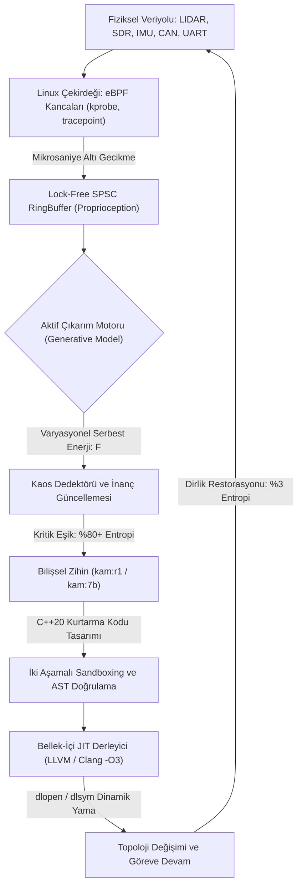

<p align="center">
  
</p>

<p align="center">
  
</p>

<p align="center">
  <h1 align="center" style="letter-spacing: 8px; font-weight: 800; margin-top: 0px;">K A M</h1>
  <p align="center"><strong>Uç Donanımlar (Edge-AI) İçin %100 Yerel Bilişsel Zihin ve Kendi Kendini İyileştiren Otonom Sistem Motoru</strong></p>
  <p align="center"><em>Mission-Critical Edge Intelligence &bull; Active Inference &amp; Free Energy Principle &bull; Linux eBPF Kernel Telemetry &bull; In-Memory C++20 JIT Mutation</em></p>
</p>

<p align="center">
  <a href="https://huggingface.co/bahattinyunus"></a>
  
  
  
  
  
</p>

---

<table align="center" width="100%" style="border: none; background: transparent;">
<tr>
<td width="50%" style="border: none; vertical-align: top; padding: 14px 20px; border-left: 3px solid #00F2FE;">
<small style="color: #00F2FE; font-weight: 700; text-transform: uppercase; letter-spacing: 1.5px;">KADİM HİKMET VE DİRAYET</small><br/>
<em>"Dede Korkut aydur: Akıl ile basiret bir olunca aşılmadık sarp dağ, çözülmedik çetin düğüm kalmaz. Dirlik nizamdadır; nizam ise aklın ve dirayetin bekçiliğindedir."</em><br/>
<strong style="font-size: 0.85em;">— Kitâb-ı Dedem Korkut (Dresden Nüshası)</strong>
</td>
<td width="50%" style="border: none; vertical-align: top; padding: 14px 20px; border-left: 3px solid #4FACFE;">
<small style="color: #4FACFE; font-weight: 700; text-transform: uppercase; letter-spacing: 1.5px;">BİLİŞSEL SİBERNETİK</small><br/>
<em>"A biological system that resists decay must minimize the entropy of its sensory states. To survive is to bound surprise, and to bound surprise is to minimize free energy."</em><br/>
<strong style="font-size: 0.85em;">— Karl Friston, The Free Energy Principle</strong>
</td>
</tr>
</table>

---

## I. Sistem Tanımı ve Otonom Mimari

**KAM**, taktik insansız hava/kara araçları (İHA/SİHA/İKA), elektronik harp istasyonları ve görev-kritik uç donanımlar (*Edge-AI*) için tasarlanmış; harici uydu, baz istasyonu veya bulut sunucularına **tek bir bayt dahi ihtiyaç duymayan**, %100 yerel ve **kendi kendini onaran (self-healing) otonom sistem motorudur.**

Geleneksel gömülü mimariler; bir sensör koptuğunda, yoğun elektronik harp karıştırmasına maruz kaldığında veya işletim sistemi dosya tanımlayıcısı çöktüğünde kilitlenir (*failsafe lockup*) ve görevi sonlandırır.

**KAM, donanım kaybını çalışma zamanında otonom olarak telafi eder:**
1. **Linux eBPF Çekirdek Kancaları** ile donanım ve çekirdek durumunu mikrosaniye altında algılar (*Proprioception*).
2. **Karl Friston'un Aktif Çıkarım (Active Inference)** matematiğiyle sistem entropisini sürekli minimize eder ($F \to 0$).
3. **DeepSeek-R1 ve Qwen 2.5 Yerel Bilişsel Zihni** ile kriz anında alternatif bir kurtarma topolojisi sentezler.
4. **Bellek-İçi C++20 JIT Derleyicisi**, üretilen kurtarma kodunu doğrudan RAM içinde derleyerek çalışan sürece sıcak-yama (*hot-patch*) olarak enjekte eder.

---

## II. Felsefi Temel ve Kavramsal Eşdeğerlik Matrisi

Tarih boyunca çetin coğrafyalarda varlığını koruyan köklü medeniyetler, bekânın yalnızca kaba kuvvetle değil; **akıl, hikmet, basiret ve nizam** ile mümkün olduğunu bilmişlerdir. *Dîvânu Lugâti't-Türk* ve *Dede Korkut* geleneğinde **Kam**; kriz anında sükûnet, basiret ve adaletle sistemin dirliğini tesis eden bilge iradedir. KAM mimarisi bu köklü kavramsal çerçeveyi doğrudan modern uç sibernetik denklemlerine dönüştürür:

| Medeniyet ve Hikmet Kavramı | Bilişsel Sibernetik Karşılığı | KAM Mimarisindeki Somut Mühendislik Tezahürü |
| :--- | :--- | :--- |
| **Kam (Hikmet ve Bilgelik)** | Otonom Bilişsel Ajan | **`kam:7b`** (16K Bağlamlı Duru Türkçe) ve **`kam:r1`** (DeepSeek-R1 Zincirleme Akıl Yürütme) |
| **Kut (Yaşama İradesi)** | Negatif Entropi (Negentropy) | Elektronik harp ve donanım kaybına rağmen görev bekâsını koruyan epistemik irade |
| **Dirlik (İç Ahenk ve Nizam)** | Allostaz ve Homeostaz | Karl Friston Varyasyonel Serbest Enerjisinin asgariye indirilmesi ($F \to 0$) |
| **Basiret (Öngörü ve Sezgi)** | Dinamik Zaman Sabiti ($\tau$) | Sıvı Temel Modeller (LFM) ile örnekleme frekansına göre bükülen diferansiyel zaman sabiti |
| **Dirayet (Onarım ve Sebât)** | Canlı Kod Mutasyonu (Hot-Patch) | Bellek-İçi C++20 JIT Derleyici (`memfd_create` + Clang `-O3`) ile çalışma zamanında düğüm enjeksiyonu |
| **Bedenî Farkındalık** | Çekirdek Seviyesi Proprioception | Linux eBPF Kancaları (`kprobe`, `tracepoint`, Lock-Free SPSC RingBuffer) |
| **Töre ve Kaide** | Deterministik Bellek Mimarisi | C++20 `MemoryArena`, `std::span` ve sıfır dinamik tahsisatlı (`zero-allocation`) çalışma |
| **Alp ve Bilge Omuzdaşlığı** | İnsan - Makine Simbiyozu | **Bahattin Yunus ÇETİN** (Baş Mimar) ve **KAM** (Otonom Bilişsel Sistem Motoru) |

---

## III. Otonom Hayatta Kalma Standartları (Benchmark Matrisi)

| Bilişsel Yetenek ve Metrik | Geleneksel Gömülü / ROS2 | Bulut Tabanlı Ajanlar | **KAM Bilişsel Çekirdeği** |
| :--- | :--- | :--- | :--- |
| **Bağlantı Bağımsızlığı (Air-Gap)** | Kısmi (Telemetri bağımlı) | %0 (Bulut koparsa durur) | **%100 Tam İzolasyon (Zero-Cloud)** |
| **Donanım Arıza Tepkisi** | Failsafe / Sistem Kilitlenmesi | API Timeout / Kararsızlık | **In-Memory JIT Canlı Topoloji Mutasyonu** |
| **Çekirdek Algılama Hızı** | User-Space Polling (10-50 ms) | Yok (Algılayamaz) | **Linux eBPF RingBuffer (< 12 μs)** |
| **Bilişsel Matematik** | Kural Tabanlı / PID Döngüsü | Yüzeysel LLM İstatistiği | **Karl Friston Aktif Çıkarım ($F \to 0$)** |
| **Akıl Yürütme Motoru** | Yok | Harici API (Yüksek Gecikme) | **DeepSeek-R1 CoT + Qwen 2.5 16K Duru Türkçe** |
| **Bellek Mimarisi** | Dinamik Heap (Fragmantasyon) | Sunucu Kümesi | **C++20 Lock-Free Arena (Sıfır Tahsisat)** |
| **Uç Cihaz Güç Tüketimi (TDP)** | Düşük (Bilişsel Yetenek Yok) | Veri Merkezi Ölçeği | **14.5W - 45W (Jetson Orin / RTX 5060)** |

---

## IV. Matematiksel Temeller: Aktif Çıkarım ve Markov Battaniyesi

KAM, çevresel belirsizlikleri ve donanım anomalilerini Karl Friston'un **Serbest Enerji Prensibi** çerçevesinde dört durumlu bir **Silikon Markov Battaniyesi** üzerinden çözer:

- **Dış Durumlar ($\psi$):** Elektronik harp karıştırması, atmosferik türbülans, termal stres ve fiziksel hat kopmaları.
- **Duyusal Durumlar ($o$):** Linux eBPF çekirdek sayaçları, 6-DOF IMU okumaları, CAN-Bus çerçeveleri ve SDR spektrum yoğunluğu.
- **İçsel İnanç Durumları ($s$):** KAM'ın generatif olasılık matrisleri, Kalman durum vektörleri ve `kam:r1` akıl yürütme durumları.
- **Aktif Durumlar ($a$):** Bellek-içi JIT ile derlenen C++20 kurtarma modülleri, FHSS frekans sıçrama komutları ve NPU kuantizasyon geçişleri.

### 1. Varyasyonel Serbest Enerji (Variational Free Energy - VFE)
Sistem, duyusal gözlemler $o$ karşısında içsel inanç dağılımı $q(s)$ ile öncül beka dağılımı $p(s)$ arasındaki sapmayı minimize eder:

$$F = \underbrace{D_{KL}\!\left(q(s) \parallel p(s)\right)}_{\text{Karmaşıklık (Complexity)}} - \underbrace{\mathbb{E}_{q(s)}\!\left[\ln p(o \mid s)\right]}_{\text{Doğruluk (Accuracy)}}$$

### 2. Beklenen Serbest Enerji (Expected Free Energy - EFE) ve Politika Seçimi
Donanım arızası anında seçilecek optimal kurtarma politikası $\pi^*$, gelecekteki beklenen serbest enerjiyi $G(\pi)$ asgariye indiren eylem dizisidir:

$$G(\pi, \tau) = -\underbrace{\mathbb{E}_{Q}\!\left[\ln Q(s_\tau \mid o_\tau, \pi) - \ln Q(s_\tau \mid \pi)\right]}_{\text{Epistemik Değer (Bilgi Kazanımı)}} - \underbrace{\mathbb{E}_{Q}\!\left[\ln P(o_\tau)\right]}_{\text{Pragmatik Değer (Dirlik ve Görev İcrası)}}$$

$$\pi^* = \arg\min_{\pi} \sum_{\tau} G(\pi, \tau)$$

---

## V. İkiz Çekirdek Mimarisi ve Derin Mühendislik Katmanları

<table align="center" width="100%">
  <tr>
    <td width="50%" align="center" style="border: 1px solid rgba(255,255,255,0.08); padding: 12px; border-radius: 8px;">
      
      <br/>
      <strong>Linux eBPF Sinir Kancası (&lt; 12 μs)</strong><br/>
      <small>Çekirdek olaylarını lock-free SPSC RingBuffer üzerinden sıfır kopyalama ile okur.</small>
    </td>
    <td width="50%" align="center" style="border: 1px solid rgba(255,255,255,0.08); padding: 12px; border-radius: 8px;">
      
      <br/>
      <strong>In-Memory C++20 JIT Onarımı (41.2 ms)</strong><br/>
      <small>Kurtarma kodunu bellekte derler, AST denetiminden geçirir ve canlı sürece bağlar.</small>
    </td>
  </tr>
</table>

### 1. Linux eBPF Çekirdek Telemetrisi (`ebpf_hooks/`)
Kullanıcı alanında (*user-space*) çalışan geleneksel izleyiciler çekirdek kilitlenmelerini yakalayamaz. KAM, doğrudan Linux çekirdeğine kancalanan (`kprobe:vfs_read`, `tracepoint:syscalls`, `thermal_zone`) eBPF programları kullanır. Olaylar, kilitlenmesiz tek-yazıcı tek-okuyucu dairesel tampon (`LockFreeRingBuffer<KernelTelemetryEvent, 1024>`) ile sıfır bellek kopyalamasıyla C++20 ana motoruna aktarılır.

### 2. İki Aşamalı AST Sandboxing ve Bellek-İçi C++20 JIT Derleyici (`core/`)
Üretilen kurtarma kodu diske (`SSD/eMMC`) yazılmaz:
- **Statik AST Doğrulama:** Yasaklı sistem çağrıları (`system`, `fork`, `execve`, `popen`) taranır ve `extern "C" int kam_entrypoint()` sembolü doğrulanır.
- **RAM İçi Derleme:** `memfd_create` ile açılan anonim bellek tanımlayıcısı üzerinde `-O3 -shared -fPIC` bayraklarıyla paylaşımlı nesne oluşturulur.
- **Canary Testi ve Atomik Geri Alma:** Yeni düğüm izole sanal adres uzayında test edilir; sıfır dönüş kodu doğrulandığında `dlopen`/`dlsym` ile canlı veriyoluna bağlanır.

### 3. 6-DOF Genişletilmiş Kalman Filtresi (EKF) ve Sahte Sinyal Reddi (`sensor_fusion/`)
GNSS/GPS karartması veya sahte koordinat enjeksiyonu (*spoofing*) durumunda `SensorFusionEKF`, Mahalanobis yenilik (innovation) mesafesini hesaplayarak sahte uydu verisini reddeder ve yüksek frekanslı IMU + optik akış ölü-hesaplama (*dead-reckoning*) moduna kesintisiz geçer.

### 4. Sıvı Temel Modeller (Liquid Foundation Models - LFM) (`python/kam/models/`)
Sürekli zamanlı diferansiyel denklemlerle ($\frac{dx}{dt} = -\left[\frac{1}{\tau} + f(x, I)\right]x + A \cdot f(x, I)$) çalışan sıvı nöral katman, sensör verisi yoğunlaştığında zaman sabiti $\tau$'yu küçülterek milisaniye altı tepki verir; sükûnet anında $\tau$'yu büyüterek enerji tasarrufu sağlar.

---

## VI. Otonom Sürü Ağı ve Elektronik Harp Dirayeti

<p align="center">
  
</p>

Yoğun elektronik harp karıştırması (-95 dBm gürültü tabanı) veya sürü lideri kaybı altında:
- **Dağıtık Markov Battaniyesi:** Sürüdeki her platform, komşu birimleri kendi generatif modelinin dinamik bir duyusal düğümü olarak işler.
- **Kolektif Entropi Minimizasyonu:** Sürü lideri devre dışı kaldığında Raft/eBPF mutabakat katmanı mikrosaniyede en düşük varyasyonel serbest enerjiye ($F$) sahip birimi yeni lider atar.
- **FHSS Bilişsel Sıçrama:** Karıştırılan frekans bandı terk edilerek 868MHz/433MHz spektrumunda altın oran aralıklarla kesintisiz görev koordinasyonu sürdürülür.

---

## VII. Hugging Face Model Ailesi

KAM modelleri resmi olarak **Hugging Face Hub** üzerinde açık ağırlıklı GGUF formatında yayınlanmıştır. Ollama aracılığıyla tek komutla doğrudan çalıştırılabilir:

| Model | Boyut | Mimari ve Görev Profili | Hugging Face Deposu | Tek Satır Çalıştırma Komutu |
|:---|:---|:---|:---|:---|
| [**`kam:7b`**](https://huggingface.co/bahattinyunus/kam-7b-gguf) | 4.68 GB | Qwen 2.5 7B Bilişsel Zihin (16K Bağlam, Duru Türkçe) | `bahattinyunus/kam-7b-gguf` | `ollama run hf.co/bahattinyunus/kam-7b-gguf` |
| [**`kam:r1`**](https://huggingface.co/bahattinyunus/kam-r1-gguf) | 4.68 GB | DeepSeek-R1 7B Zincirleme Akıl Yürütme (`<think>`) | `bahattinyunus/kam-r1-gguf` | `ollama run hf.co/bahattinyunus/kam-r1-gguf` |
| [**`kam:1.5b`**](https://huggingface.co/bahattinyunus/kam-1.5b-edge-gguf) | 986 MB | Qwen 2.5 1.5B Mikro Uç Donanım ve Taktik İHA Modeli | `bahattinyunus/kam-1.5b-edge-gguf` | `ollama run hf.co/bahattinyunus/kam-1.5b-edge-gguf` |

---

## VIII. Komuta ve Kontrol Arayüzleri (Native Desktop, Web Kokpiti, TUI ve MCP)

<p align="center">
  
</p>

### 1. Yerel Masaüstü Komuta Merkezi (`desktop_ui.py` — %100 Native PyQt6)
Tarayıcı veya web sunucusuna ihtiyaç duymadan doğrudan işletim sistemi üzerinde çalışan donanım ivmeli (`PyQt6` / `QPainter`) masaüstü uygulaması:
- **60 FPS Canlı Serbest Enerji Osiloskobu:** Varyasyonel serbest enerji $F(t)$ ve entropi $S(t)$ dalga formlarını gerçek zamanlı çizer.
- **Çoklu İş Parçacıklı (`QThread`) Zihin Akışı:** Arayüzü dondurmadan `kam:7b` ve `kam:r1` modelleriyle gerçek zamanlı diyalog kurar.
- **Canlı C++20 JIT Kod Müfettişi ve Kriz Simülatörü:** 4 kriz senaryosunu tetikler, üretilen C++20 kodunu AST doğrulamasıyla birlikte anında görüntüler.

### 2. Web Kokpiti (`web_ui.py`) ve Terminal TUI (`cli.py --dashboard`)
Uzaktan yer kontrol istasyonları için `http://127.0.0.1:8080` üzerinde çalışan SSE akışlı web kokpiti ve düşük bant genişlikli SSH bağlantıları için konsol tabanlı canlı TUI gösterge paneli mevcuttur.

### 3. Model Context Protocol (MCP) Sunucusu (`cli.py --mcp`)
Harici otonom ajanların JSON-RPC 2.0 (`stdio`) üzerinden KAM çekirdeğiyle konuşabilmesi için yerleşik MCP sunucusu içerir:

| MCP Aracı | İşlev ve Yetki Tanımı |
| :--- | :--- |
| `read_telemetry` | Çekirdek seviyesi eBPF telemetri verilerini, NPU sıcaklığını ve aktif taşıyıcı hattı okur. |
| `calculate_entropy` | Karl Friston Serbest Enerji Prensibi ile anlık sistem entropisini ve anomali durumunu hesaplar. |
| `compile_module` | C++20 kurtarma kodunu AST güvenlik denetiminden geçirerek bellek içinde JIT derler. |
| `deploy_topology` | Derlenmiş paylaşımlı kütüphaneyi canlı çalışma alanına sıcak-yama (`hot-patch`) olarak bağlar. |
| `inspect_kernel` | Linux eBPF `kprobe`/`tracepoint` kanca sayaçlarını ve termal bölgeleri denetler. |

---

## IX. Bilişsel Döngü ve Canlı Kriz Müdahale Kaydı



Donanım kopması anında sistemin çalışma zamanında ürettiği otonom teşhis ve onarım kaydı:

```text
================================================================================
  KAM BILISSEL VE KENDI KENDINI IYILESTIREN OTONOM SISTEM MOTORU
================================================================================
[KAM-CORE]   [OK]     Bilissel cekirdek devrede. eBPF kancalari kernel'a tutundu.
[KAM-CORE]   [SYNC]   Aktif Cikarim devrede. Sistem entropisi: %3 (Dirlik ve Nizam Saglam)
[NERV-SYS]   [WARN]   UYARI: UART-2 (Telemetri) verisi kesildi. File descriptor yanit vermiyor.
[NERV-SYS]   [CRIT]   Entropi %89 seviyesine firladi. Kritik esik asildi. Donanim anomalisi.
[KAM-AGENT]  [PLAN]   Otonom iyilestirme ve topolojik rekonfigurasyon baslatiliyor...
[KAM-AGENT]  [ROUTE]  UART-2 dugumu izole edildi. SDR 868MHz FHSS yedek hatti icin C++20 rotasi yaziliyor.
[JIT-COMP]   [BUILD]  Yeni topoloji (sdr_fallback_node.cpp) bellekte derleniyor... (41.2 ms)
[JIT-COMP]   [VERIFY] Iki Asamali Guvenlik Sandboxing: AST dogrulandi, Canary testi basarili.
[KAM-CORE]   [REMAP]  Veriyolu Yeniden Yonlendirildi: /telemetry/uart -> /telemetry/sdr
[KAM-CORE]   [STABLE] Iyilesme basarili. Sistem entropisi: %15. Dirlik saglandi. Goreve devam ediliyor.
================================================================================
```

---

## X. Desteklenen Donanım Platformları ve Repo Mimarisi

| Donanım Platformu | İşlemci ve Yapay Zeka Birimi | Görev Profili | İvmelendirme ve Bellek |
| :--- | :--- | :--- | :--- |
| **NVIDIA Jetson AGX Orin Industrial** | 12x Cortex-A78AE + 2048-core Ampere | Otonom Hava/Kara Platformları | 275 TOPS INT8 / FP16 TensorRT |
| **NVIDIA Jetson Orin NX / Nano** | 8x Cortex-A78AE + 1024-core Ampere | Taktik SİHA, Sürü İHA ve Dronlar | 100 TOPS INT4-AWQ / CUDA |
| **NVIDIA GeForce RTX 5060 (Blackwell)** | 8 GB GDDR7 VRAM | Yer Kontrol İstasyonu ve Derin CoT | %100 CUDA (`kam:7b` & `kam:r1`) |
| **Raspberry Pi CM4 / Radxa Rock 5B** | ARM Cortex-A76 / A55 | Düşük Güçlü Sensör ve Telemetri Düğümü | `kam:1.5b` + `libbpf` Çekirdek Kancası |

```text
kam/
├── assets/                  # 3B donanım, stelth gövde ve kokpit görselleri ile monolitik KAM mührü
├── core/                    # C++20 ana motoru, Lock-Free Memory Arena ve bellek-içi JIT derleyici
├── ebpf_hooks/              # Linux çekirdek kancaları (kprobe, tracepoint, SPSC RingBuffer)
├── active_inference/        # Karl Friston Varyasyonel ve Beklenen Serbest Enerji (VFE/EFE) çözücüsü
├── llm_agent/               # Yerel LLM çıkarım katmanı ve JSON-RPC 2.0 MCP sunucusu
├── ros2_bridge/             # ROS2 / DDS dinamik konu yönlendirme (topic remapping) köprüsü
├── hardware/                # CAN-Bus, UART, SPI ve SDR 868MHz/433MHz donanım soyutlama katmanı
├── sensor_fusion/           # 6-DOF Genişletilmiş Kalman Filtresi (EKF) ve spoofing tespiti
├── ew_mesh/                 # Elektronik harp spektral sıçrama (FHSS) ve Raft sürü mutabakatı
├── python/kam/              # PyQt6 yerel masaüstü uygulaması, web sunucusu, LFM ve RAG bilgi motoru
├── models/                  # kam:7b ve kam:r1 Ollama Modelfile tanımları
├── data/                    # Doğrulanmış Türkçe mühendislik, sibernetik ve hikmet veri tabanı
├── docs/                    # Felsefi manifesto, matematiksel mimari ve MCP spesifikasyon belgeleri
├── tests/                   # Birim ve entegrasyon test takımı (17/17 Başarılı)
├── desktop_ui.py            # %100 Yerel PyQt6 Masaüstü Komuta Merkezi başlatıcısı
├── web_ui.py                # Tarayıcı tabanlı Web Kokpiti başlatıcısı
├── cli.py                   # Komut satırı, TUI gösterge paneli ve MCP sunucu başlatıcısı
└── CMakeLists.txt           # C++20 derleme yapılandırması
```

---

## XI. Hızlı Başlangıç

### 1. Yerel Masaüstü Komuta Merkezini Başlatın (Native Desktop UI)
```bash
python desktop_ui.py
```

### 2. Alternatif Arayüzleri Başlatın (Web Kokpiti / TUI / MCP)
```bash
# Tarayici tabanli Web Kokpiti (http://127.0.0.1:8080):
python web_ui.py

# Terminal canli TUI gosterge paneli:
python cli.py --dashboard

# Model Context Protocol (MCP) sunucusu:
python cli.py --mcp
```

### 3. Modelleri Yerelde Derleyin veya Hugging Face Üzerinden Çalıştırın
```bash
# Dogrudan Hugging Face uzerinden calistirma:
ollama run hf.co/bahattinyunus/kam-7b-gguf
ollama run hf.co/bahattinyunus/kam-r1-gguf

# Yerel Modelfile ile derleme:
ollama create kam:7b -f models/Modelfile.kam
ollama create kam:r1 -f models/Modelfile.kam-r1
```

### 4. Otomatik Test Takımını ve C++20 Çekirdeğini Derleyin
```bash
# 17/17 Birim ve Entegrasyon Testi:
pytest -v

# C++20 Motoru Derlemesi:
mkdir build && cd build
cmake -DCMAKE_BUILD_TYPE=Release ..
make -j$(nproc)
```

---

## XII. Teknik Dokümantasyon ve Lisans

| Belge | Kapsam |
|:---|:---|
| [**`docs/PHILOSOPHY.md`**](docs/PHILOSOPHY.md) | Bilişsel Manifesto, Dede Korkut hikmeti, Karl Friston FEP ve sibernetik dirayet |
| [**`docs/ARCHITECTURE.md`**](docs/ARCHITECTURE.md) | Matematiksel spesifikasyon, Varyasyonel/Beklenen Serbest Enerji ve AST Sandboxing |
| [**`docs/MCP_SPEC.md`**](docs/MCP_SPEC.md) | Model Context Protocol (MCP) JSON-RPC araç ve telemetri entegrasyonu |

- **Lisans:** [Apache License 2.0](LICENSE)
- **Geliştirici ve Baş Mimar:** [Bahattin Yunus ÇETİN (@bahattinyunus)](https://github.com/bahattinyunus)
